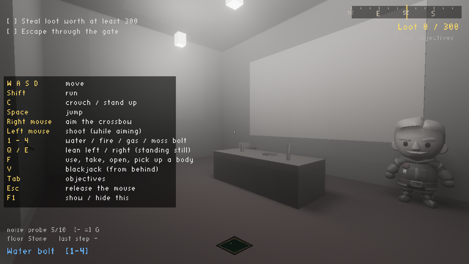
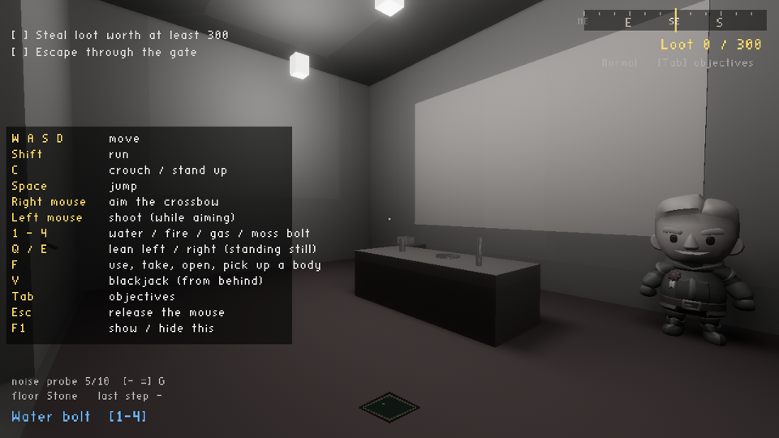
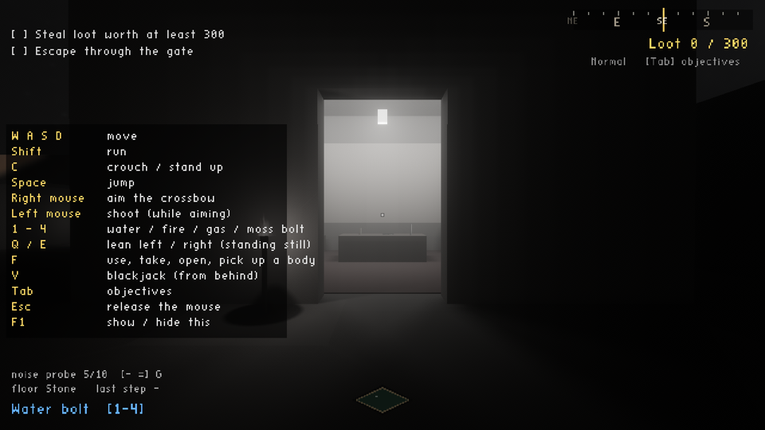
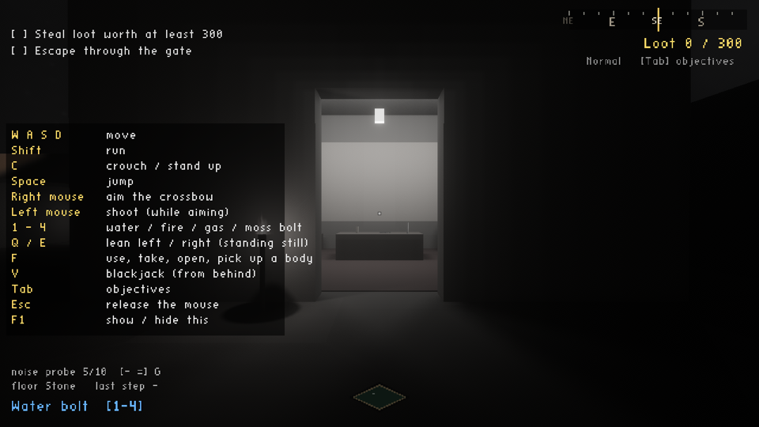

# Fog

Thick fog is the game's look (`docs/art/mood/README.md`, variant C): warm fire and cold astral light glowing in
the air, darkness between. Penumbra's fog is volumetric: lamps light it, their shadows cut it, it can lie low and
gather in places, and guards see through exactly the fog the player sees.

## What there is to set

**Environment** (the level's fog, `Components.md`):

| field | meaning | default |
|---|---|---|
| `FogDensity` | extinction per metre at ground level (0.01 a light haze, 0.06 thick, 0.15 a wall at 15 m) | 0 |
| `FogColor` | the fog's own glow where no lamp lights it (night sky, moonlight in general) | 0.05, 0.05, 0.06 |
| `FogHeight`, `FogHeightFalloff` | full density below `FogHeight`; above it the fog thins by `exp(-falloff * metres above)`. Falloff 0: the same at every height | 0, 0 |
| `VolumetricFog` | lamps light the fog (off: the fog only hides, as before) | on |
| `FogScattering` | how much of a lamp's light the fog sends towards the eye (0-1). Thick fog wants little (0.1-0.15), thin haze more | 0.5 |
| `FogAnisotropy` | -0.9..0.9: 0 scatters evenly, higher makes looking into a lamp glare | 0.3 |

**FogVolume** (local fog): a box, `HalfExtents` in metres (rotates with the entity; scale ignored), taking effect
over `EdgeFade` metres from its sides, `Enabled`. Two modes:

* `Add` (default): extra fog, `Density` per metre added inside. Mist over a garden, a cellar's haze, a bank of fog in a
  ravine.
* `Clear`: an interior. The level's fog (Environment) stays out of it; `Density` is not used. Fog from `Add` volumes
  stays, so a room can still hold its own haze. Where rooms overlap, the stronger one counts (nothing is taken away
  twice).

Up to 32 volumes of both kinds are drawn (`GPU::MaxFogVolumes`); guards see through all of them.

**Laying out an interior**: make the `Clear` box reach about `EdgeFade` into the walls, floor and roof, so the fog
fades out inside them, and end it at the outer face of the wall with the doorway, so the fog creeps `EdgeFade` metres
into the room there. The Stealth level's hall and cellar (`Tools/BuildDemoProject.py`, `HallFogClear`,
`CellarFogClear`):

| The hall, before | after |
|---|---|
|  |  |
| **Its doorway from the yard, before** | **after** |
|  |  |

Tune live in the runtime: F4 panel, "Fog and volumetric light" (`DebugTools.md`). Lua: `entity:set("Environment", {...})`,
`entity:add("FogVolume", {...})`.

## How it works

* **Density** (`Scene/FogUtils.h`, `FogMedium`): environment fog with its height profile, times `1 - ClearAt` (the
  strongest `Clear` volume at the point), plus the `Add` boxes. Perception integrates it along every sight line
  (`FogMedium::OpticalDepth`: closed form for the height fog, minus what the `Clear` volumes keep out sampled every
  0.25 m over the parts of the line inside them, 8 samples per box) and the renderer samples the same function
  (`shaders/Fog.hlsli`, `Fog.hlsl`; a `Clear` volume goes to the GPU with a negative density). Change both or neither.
* **Guards see the glow** (`docs/Perception.md`, "Fog"): perception integrates the same light the froxels hold
  (`FogMedium::Integrate`, the phase `FogPhase` and `FogUnshadowedLight` shared with the shaders), so a thief against
  lamp-lit fog stands out to them and bright fog between them hides him. A GPU test reads the froxel grid back and
  compares.
* **Froxels** (`shaders/Fog.hlsl`, compute): a grid over the view frustum (160 x 90 columns, 64 slices spaced
  quadratically out to 64 m: `SceneRendererSettings::FogGrid*`, `FogDistance`). Each froxel takes its density and
  the light it sends towards the eye: `FogColor` plus `FogScattering` of every lamp's light reaching it (the same
  falloff as surfaces, `LightUtils.h`), weighted by a Henyey-Greenstein phase (`FogAnisotropy`). Lamps with a shadow
  map shadow the fog (one tap: a wall throws a dark wedge into the glow, a doorway lets a shaft through); lamps
  without one light it at `FogUnshadowedLight` (0.5) of their strength, since they would shine through walls.
* **Temporal**: froxel samples move inside their slice every frame and blend with last frame's (reprojected, 85%),
  so slices do not band. History is dropped when the scene changes or more than 0.05 s of game time passed between
  two rendered frames (a screenshot after a jump in time starts clean: deterministic captures).
* **Integration** (`shaders/FogIntegrate.hlsl`): each column is walked outwards, summing light scattered in and
  transmittance. Mesh and sky shaders read one texel per pixel (`ApplyFog` in `Fog.hlsli`); past 64 m the
  environment fog is added analytically, unlit, and fog volumes of both kinds are not drawn there.
* Cost on an M1 Pro at a Retina window: about 0.45 ms of GPU per frame with 18 lamps (MoodLab, variant C).

## What it does not do (yet)

* Smoke volumes (`SmokeVolume`) are drawn their own way, unlit by lamps.
* Without volumetric fog (`VolumetricFog` off) only the environment's fog is drawn: volumes of both kinds are
  ignored, on screen and by guards alike.
* Flames and the HUD are drawn over the fog, unfogged.
* Only lamps with a shadow map cut shafts (`CastShadows`; lamps without it are meant for small lights that cannot
  reach past a wall). A lamp with `CastShadows` that finds no free map is left out of the picture, fog included.
