# Mood lab

Material for choosing the game's lighting (direction B: stylised realism, dark places, thick fog, warm fire,
cold astral lamps), and the test bench for the volumetric fog that came out of it (`docs/Fog.md`).

* Scene: `DemoProject/Assets/Scenes/MoodLab.pscene`, the cloister's stone (garden, covered ring, wings; generated
  by `Tools/BuildDemoProject.py`, `build_mood_lab`) without guards, the thief (`Thief.glb`) standing in the north
  corridor, three kinds of light source (wall torches where the cloister has them, fire baskets, astral lamps) and a
  bank of mist over the garden (`Mist_Garden`, a FogVolume). The east half is the warm zone, the west half the cold one.
* Variants: `DemoProject/Assets/Scripts/MoodLab/Variants.lua`, one table. Each sets the environment, the moon, the
  garden's mist and which sources burn; every other source is hidden whole.
* Renders: `docs/art/mood/MoodLab.jsonl`, from the repository root:

  ```
  PenumbraEditor --headless --exec docs/art/mood/MoodLab.jsonl --project DemoProject
  ```

  It plays the scene for a second (the thief's idle settles), then per variant applies it, steps six frames at
  1/60 s and renders two shots at 1280x720 into `v3/`. Fixed steps and a fixed seed: a rerun on the same machine
  gives byte-identical files. CTest runs it as `Automation.MoodLab` (CI, both platforms).
* Walk through a variant yourself: `PenumbraRuntime --project DemoProject --scene Scenes/MoodLab.pscene --set mood=Mixed`
  (`Base`, `Fire`, `Astral`, `Mixed`; F5 freelook to move, there is no player script; F4 tunes the fog live).

## Decision

The owner chose **C. Mixed** (2026-11-18): fire in warm zones, astral lamps in cold ones, darkness between, thick
fog. Then he approved volumetric fog to make "thick fog" look like fog (v2 below, `docs/Fog.md`).

## v3: textured walls and floor

The walls wear generated stone (`Tools/AssetGen`, `DemoProject/Assets/Textures/StoneWall`, provenance `.json` beside
each): variant 1000 (light grey limestone) on the garden walls, 1002 (dark, bluish) on the outer walls and the
wings. `UVScale` gives each wall face one tile per 2 m (about six courses), the albedo is tinted x2 (the painted
albedos average 0.10 and 0.055 linear, the flat greys they replace 0.32 and 0.18). The ground (the
corridors and wings) is generated cobblestone, variant 1001 of the `cobblestone` template (dark granite setts,
`DemoProject/Assets/Textures/Cobblestone`), one tile per 1.5 m, tinted x3 (mean 0.055 linear, the flat ground 0.22).
Roofs, grass, hedges and the fountain stay flat. Generated by `Tools/BuildDemoProject.py` (`STONE_*`, `COBBLE_*`).

| | wide | close |
|---|---|---|
| 0. Base | 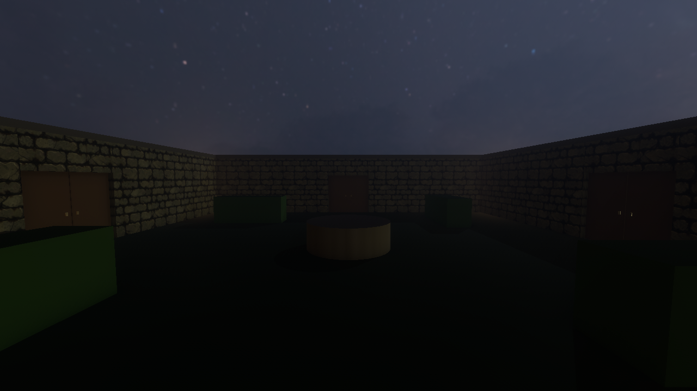 | 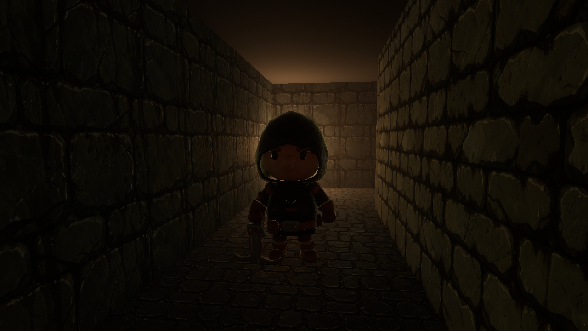 |
| A. Fire | 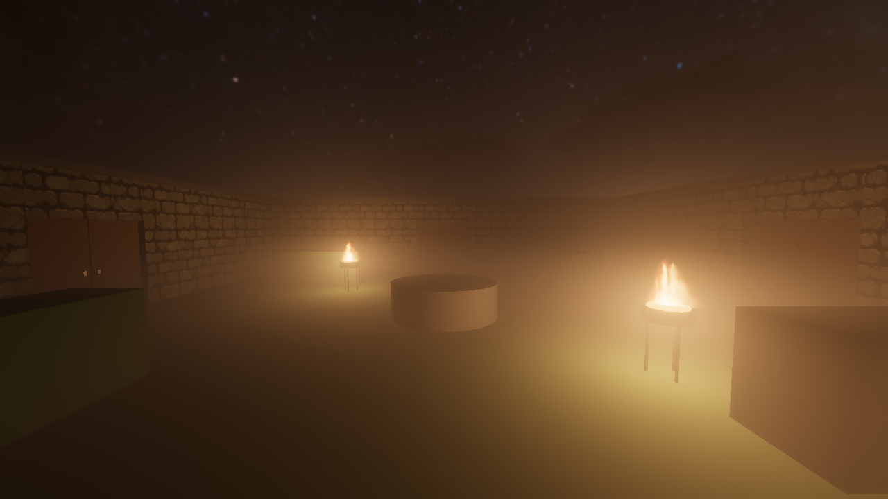 | 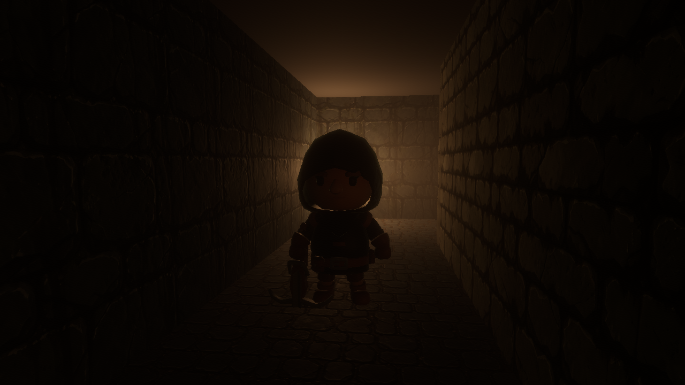 |
| B. Astral | 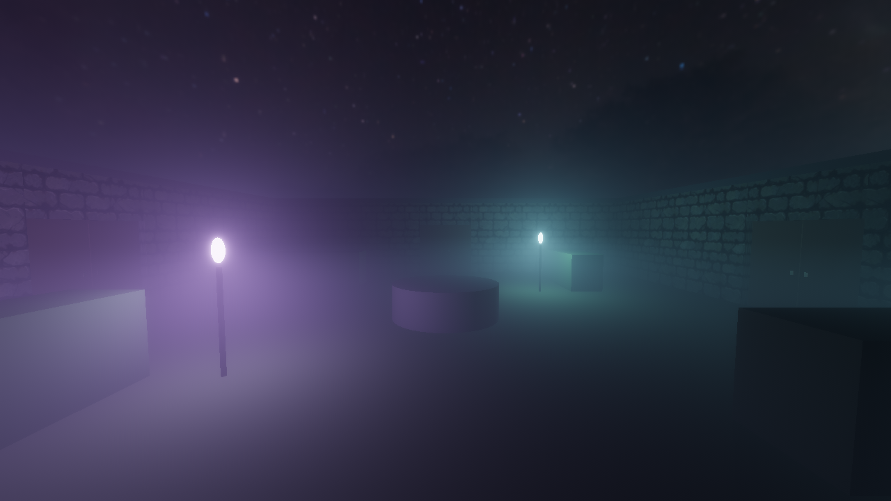 | 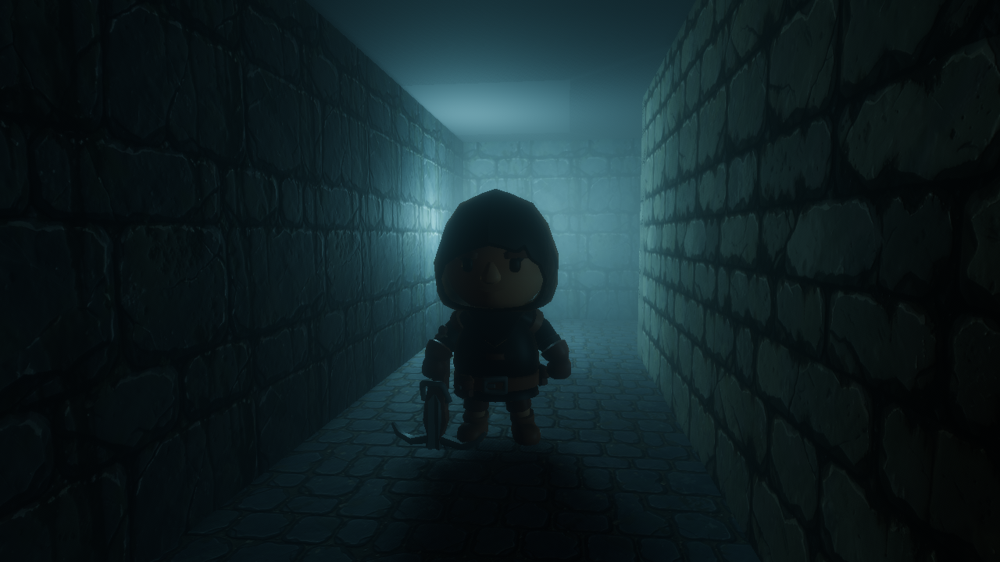 |
| C. Mixed | 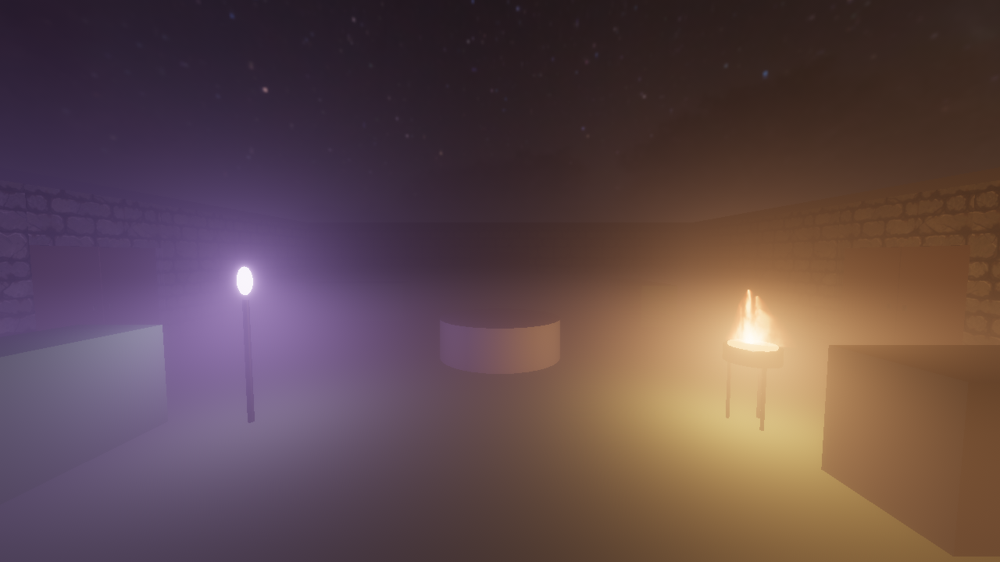 | 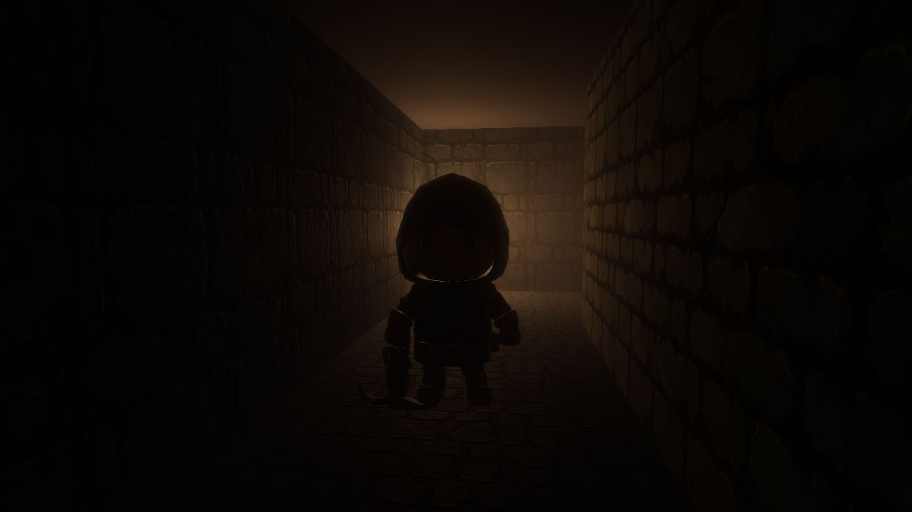 |

Limits: a wall's narrow ends and top stretch the tile (no world-space mapping), and the same 2 m tile repeats
along the long walls (up to 22.8 m). The normal map makes the lamps rake across the stone near a light (A and B
close). v2 below is the same scene with flat walls.

## v2: volumetric fog

| | wide: the garden from its south doorway (depth, fog) | close: the thief against the north-east corner's light |
|---|---|---|
| 0. Base | 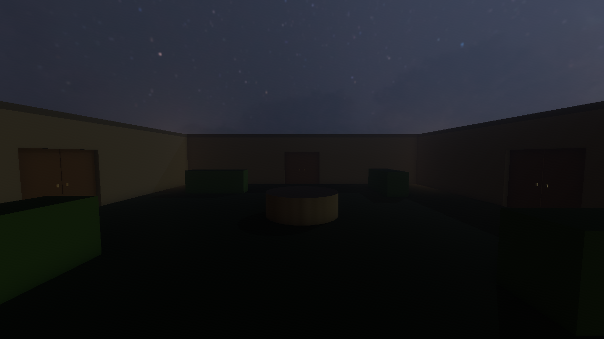 | 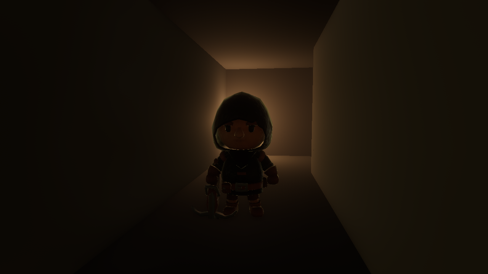 |
| A. Fire | 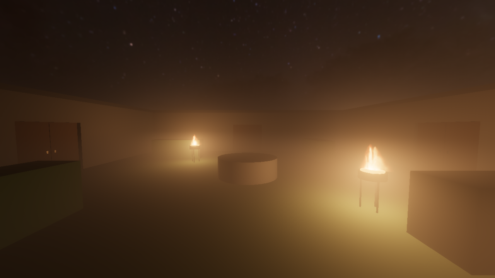 | 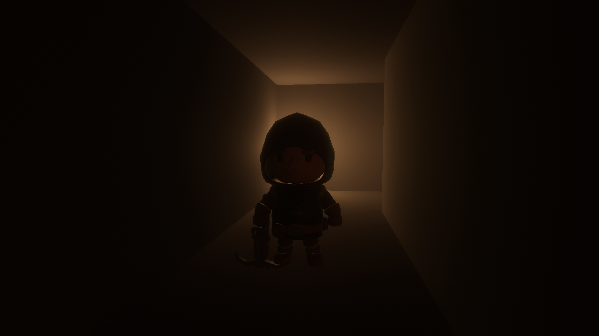 |
| B. Astral | 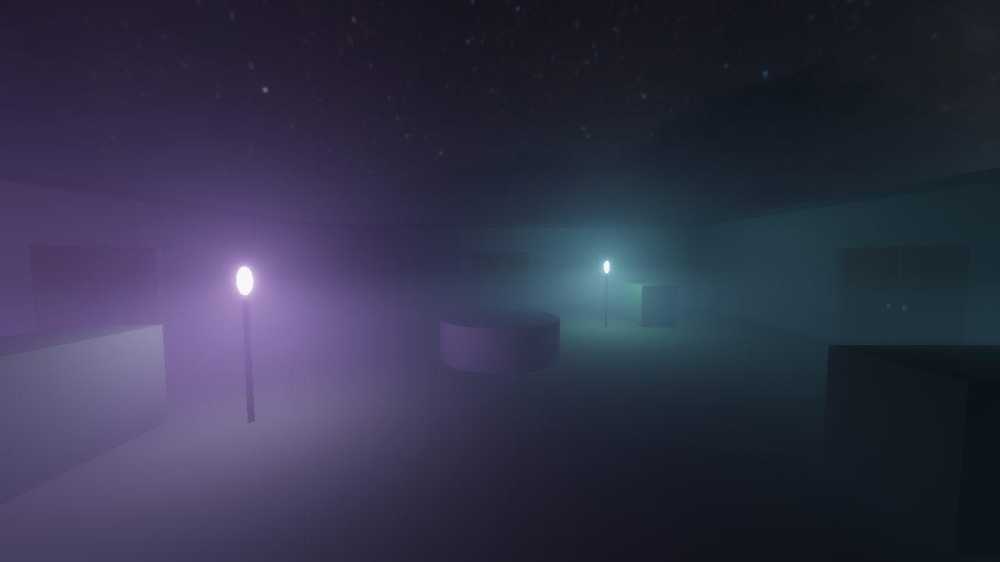 | 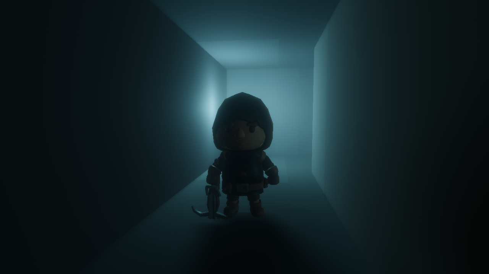 |
| C. Mixed | 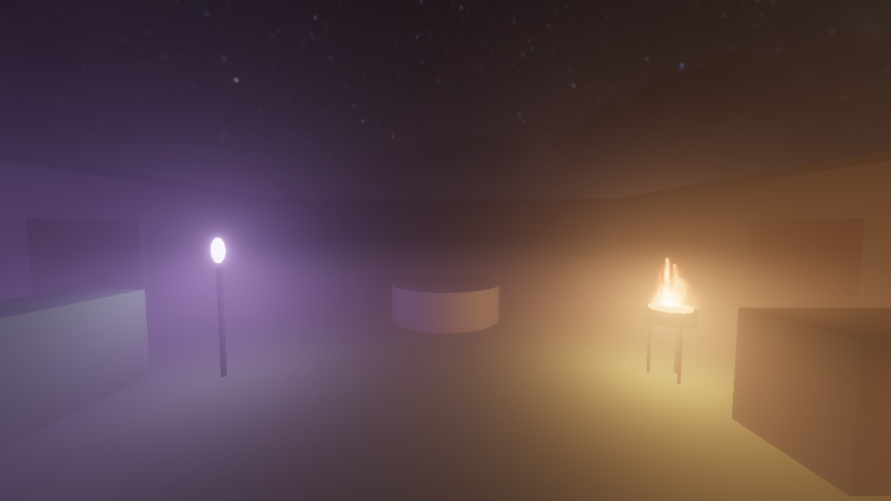 | 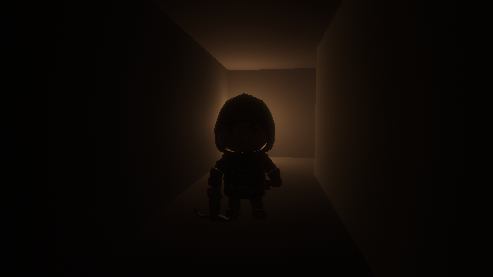 |

Cameras: wide from (0, 2.0, 7.3) to (0, 1.0, -8), 75 degrees; close from (1.2, 1.5, -9.1) to (6, 1.1, -9.7), 55 degrees.
The close shot lies in the warm zone, so in C it shows fire only; the wide shot shows both zones (cold left, warm right).

## Values

Environment (`Environment` component; the environment map is the night sky HDR in every variant):

| | FogDensity | FogColor | AmbientColor | EnvironmentIntensity | SkyboxIntensity | Exposure | BloomIntensity | Moon |
|---|---|---|---|---|---|---|---|---|
| 0. Base | 0.01 | 0.02, 0.025, 0.035 | 0.006, 0.006, 0.0084 | 0.12 | 0.6 | 1.4 | 0.05 | 0.08 |
| A. Fire | 0.06 | 0.014, 0.010, 0.008 | 0.0015, 0.0013, 0.0012 | 0.02 | 0.12 | 1.6 | 0.09 | 0.015 |
| B. Astral | 0.06 | 0.008, 0.011, 0.016 | 0.0012, 0.0014, 0.002 | 0.02 | 0.12 | 1.6 | 0.12 | 0.015 |
| C. Mixed | 0.06 | 0.011, 0.010, 0.012 | 0.0013, 0.0013, 0.0016 | 0.02 | 0.12 | 1.6 | 0.10 | 0.015 |

Fog (v2): Base keeps the engine's defaults (volumetric, `FogScattering` 0.5, `FogAnisotropy` 0.3, no height fog);
A-C share the thick fog: `FogHeight` 1.5 m, `FogHeightFalloff` 0.25, `FogScattering` 0.12, `FogAnisotropy` 0.4, and
the garden's mist on (a 15.6 x 2.4 x 15.6 m box at 0.6 m, `Density` 0.12, `EdgeFade` 0.8).

Light sources (`PointLight` unless noted; Range in metres):

| source | where | burns in | Color | Intensity | Range | Flicker | other |
|---|---|---|---|---|---|---|---|
| Wall torch (6) | the cloister's: ring corners, one per wing | Base, A; C east only | 1.0, 0.55, 0.25 | 11 | 10 | 0.18 | Flame 0.5 m high; 2 cast shadows |
| Fire basket (4) | east wing, west wing, two in the garden | A; C east only | 1.0, 0.5, 0.2 | 20 | 12 | 0.2 | Flame 0.75 m, glowing embers (Emissive 3); 2 cast shadows |
| Astral lamp, east (4) | ring, east wing, garden | B | 0.35, 0.85, 1.0 (cyan) | 14 | 10 | 0 | crystal: Material Emissive 6 in the light's colour; 1 casts shadows |
| Astral lamp, west (4) | ring, west wing, garden | B, C | 0.6, 0.4, 1.0 (violet) | 14 | 10 | 0 | as above |

## What v2 changed, what is still missing

v1 showed the fog as one exponential haze, the same everywhere and lit by nothing: thick fog read as "darker", not
"foggy". v2 (volumetric fog):

* **Light in the fog**: every lamp sits in a ball of glow, the fire baskets light the mist round them (A, C wide),
  the corridor fills with cold light behind the thief (B close), and his silhouette stands against lit air.
* **Local and height fog**: the mist lies over the garden, thinner above 1.5 m, so the roofs and the stars show
  through (A-C wide); the warm and cold halves of C each colour their own air.

Still missing (`docs/Fog.md`): guards do not see the glow (a thief against lit fog is not easier to spot); lamps
without a shadow map light the fog through walls at half strength; warm light on the green grass turns
yellow-green (A, C) and the astral crystals clip to white at the centre (B).

## v1 (before volumetric fog, PR #25)

The first renders, from the same script with the fog the engine had then, are kept in `v1/` for comparison
(FogDensity 0.07 in A-C, no mist, no height fog).
