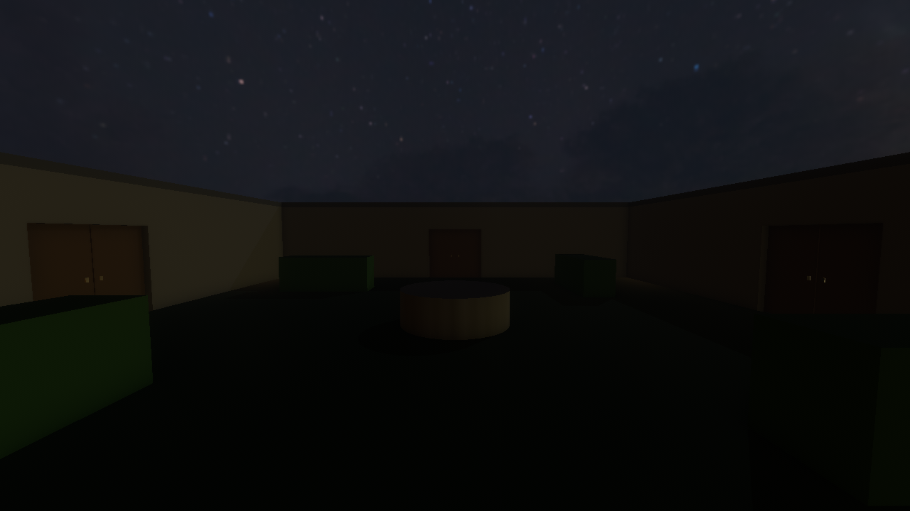
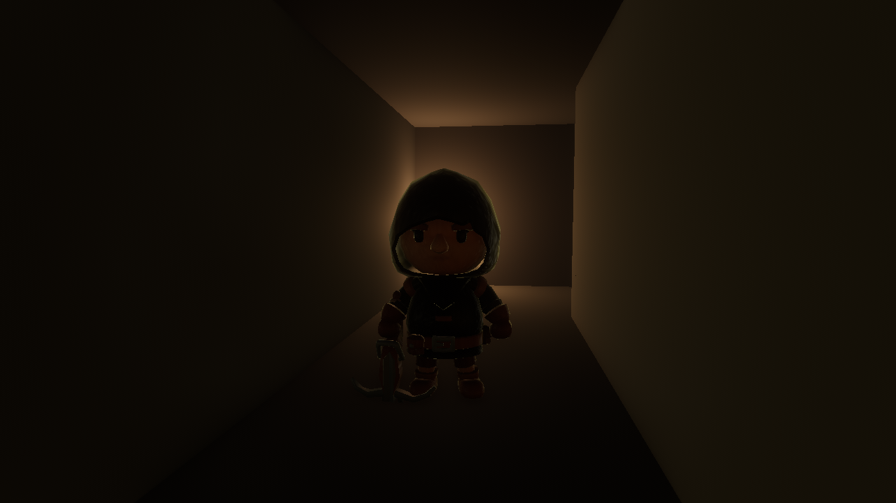
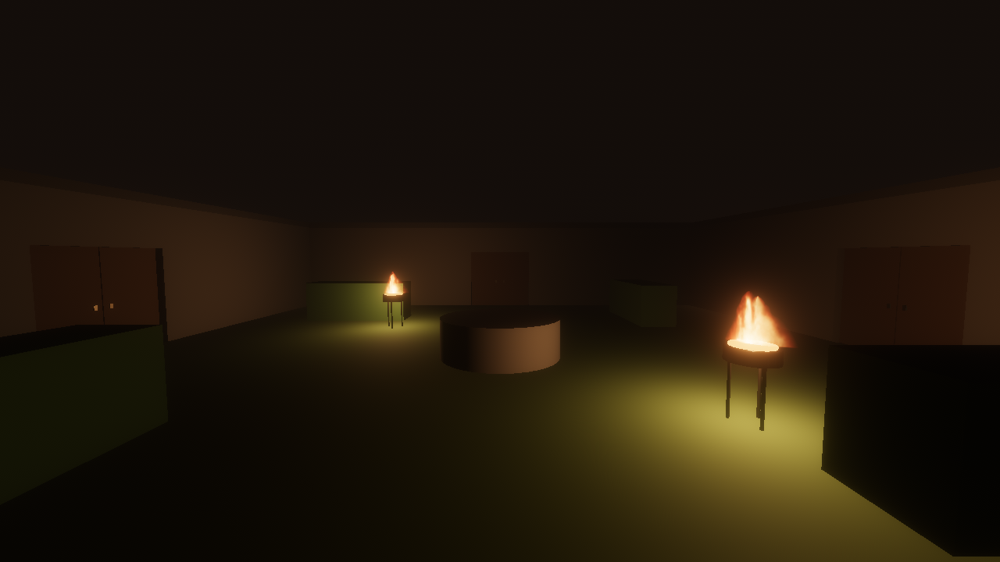
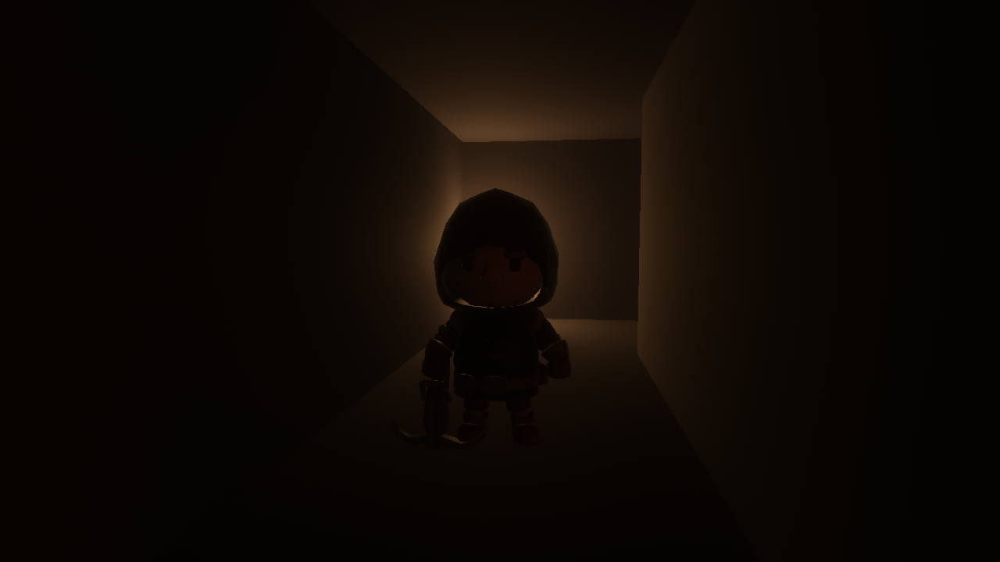
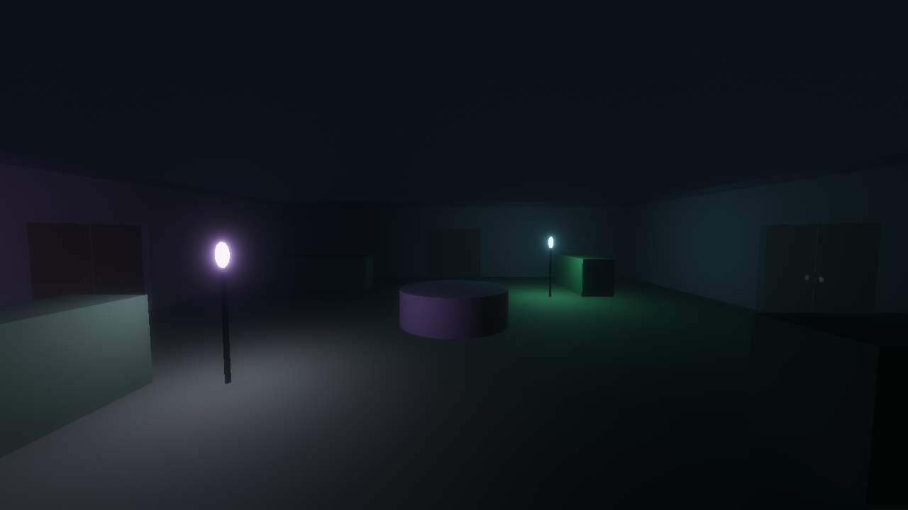
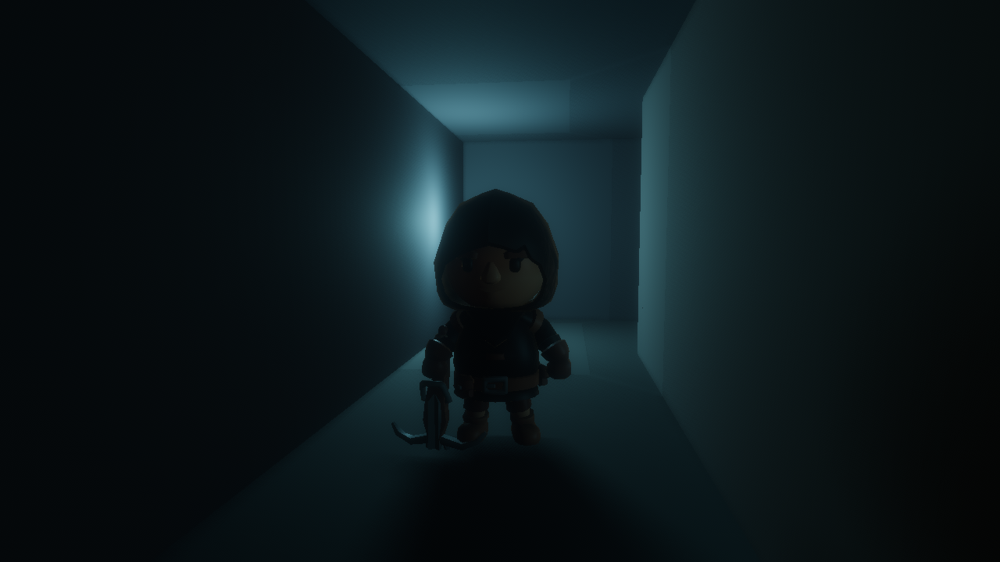
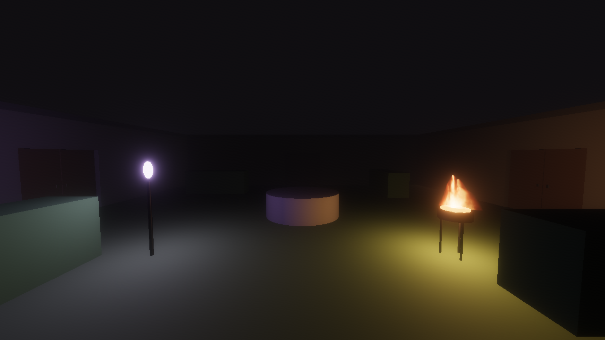
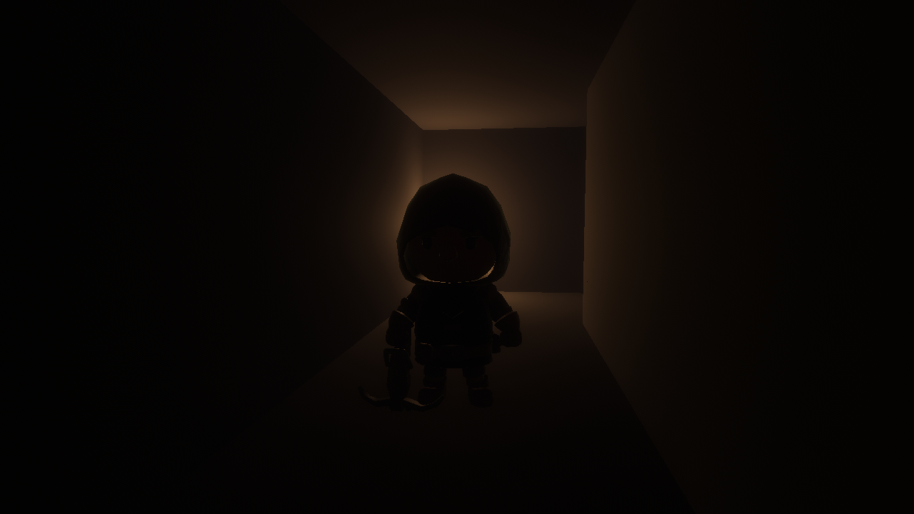

# Mood lab

Material for choosing the game's lighting (direction B: stylised realism, dark places, thick fog, warm fire,
cold astral lamps). Not an engine change: the same renderer, the same components, four sets of values.

* Scene: `DemoProject/Assets/Scenes/MoodLab.pscene`, the cloister's stone (garden, covered ring, wings; generated
  by `Tools/BuildDemoProject.py`, `build_mood_lab`) without guards, the thief (`Thief.glb`) standing in the north
  corridor, and three kinds of light source: wall torches (where the cloister has them), fire baskets and astral
  lamps. The east half is the warm zone, the west half the cold one.
* Variants: `DemoProject/Assets/Scripts/MoodLab/Variants.lua`, one table. Each sets the environment, the moon and
  which sources burn; every other source is hidden whole.
* Renders: `docs/art/mood/MoodLab.jsonl`, from the repository root:

  ```
  PenumbraEditor --headless --exec docs/art/mood/MoodLab.jsonl --project DemoProject
  ```

  It plays the scene for a second (the thief's idle settles), then per variant applies it, steps six frames at
  1/60 s and renders two shots at 1280x720 into `v1/`. Fixed steps and a fixed seed: a rerun on the same machine
  gives byte-identical files. CTest runs it as `Automation.MoodLab` (CI, both platforms).
* Walk through a variant yourself: `PenumbraRuntime --project DemoProject --scene Scenes/MoodLab.pscene --set mood=Mixed`
  (`Base`, `Fire`, `Astral`, `Mixed`; F5 freelook to move, there is no player script).

## Shots

| | wide: the garden from its south doorway (depth, fog) | close: the thief against the north-east corner's light |
|---|---|---|
| 0. Base |  |  |
| A. Fire |  |  |
| B. Astral |  |  |
| C. Mixed |  |  |

Cameras: wide from (0, 2.0, 7.3) to (0, 1.0, -8), 75 degrees; close from (1.2, 1.5, -9.1) to (6, 1.1, -9.7), 55 degrees.
The close shot lies in the warm zone, so in C it shows fire only; the wide shot shows both zones (cold left, warm right).

## Values

Environment (`Environment` component; the environment map is the night sky HDR in every variant):

| | FogDensity | FogColor | AmbientColor | EnvironmentIntensity | SkyboxIntensity | Exposure | BloomIntensity | Moon |
|---|---|---|---|---|---|---|---|---|
| 0. Base | 0.01 | 0.02, 0.025, 0.035 | 0.006, 0.006, 0.0084 | 0.12 | 0.6 | 1.4 | 0.05 | 0.08 |
| A. Fire | 0.07 | 0.014, 0.010, 0.008 | 0.0015, 0.0013, 0.0012 | 0.02 | 0.12 | 1.6 | 0.09 | 0.015 |
| B. Astral | 0.07 | 0.008, 0.011, 0.016 | 0.0012, 0.0014, 0.002 | 0.02 | 0.12 | 1.6 | 0.12 | 0.015 |
| C. Mixed | 0.07 | 0.011, 0.010, 0.012 | 0.0013, 0.0013, 0.0016 | 0.02 | 0.12 | 1.6 | 0.10 | 0.015 |

Light sources (`PointLight` unless noted; Range in metres):

| source | where | burns in | Color | Intensity | Range | Flicker | other |
|---|---|---|---|---|---|---|---|
| Wall torch (6) | the cloister's: ring corners, one per wing | Base, A; C east only | 1.0, 0.55, 0.25 | 11 | 10 | 0.18 | Flame 0.5 m high; 2 cast shadows |
| Fire basket (4) | east wing, west wing, two in the garden | A; C east only | 1.0, 0.5, 0.2 | 20 | 12 | 0.2 | Flame 0.75 m, glowing embers (Emissive 3); 2 cast shadows |
| Astral lamp, east (4) | ring, east wing, garden | B | 0.35, 0.85, 1.0 (cyan) | 14 | 10 | 0 | crystal: Material Emissive 6 in the light's colour; 1 casts shadows |
| Astral lamp, west (4) | ring, west wing, garden | B, C | 0.6, 0.4, 1.0 (violet) | 14 | 10 | 0 | as above |

## Where the engine falls short

The fog today is one exponential haze over the whole frame (`FogDensity`, `FogColor`), the same everywhere and lit
by nothing. Two things it would need for this direction, and where the shots show it most:

* **Light in the fog (halos, in-scattering).** A_fire_wide and B_astral_wide: the fire baskets and crystals are
  bright, yet the air round them stays as dark as the far wall. In thick fog a lamp should sit in a ball of glow
  and throw a lit cone through the haze; here the fog only darkens with distance, so "thick fog" reads as
  "darker" rather than "foggy". Bloom gives the crystal a small rim (B), nothing larger. The close shots show
  the same: the thief's rim light comes from the wall behind him, not from lit air.
* **Local fog.** Every variant: the fog density is one number for the level. Mist lying in the garden while the
  covered ring stays clear, or a cellar thicker than a hall, cannot be set. In C_mixed_wide the warm and cold
  halves would separate much better with a low layer of fog over the grass catching each zone's colour.

Also seen: warm light on the green grass turns yellow-green (A, C); the astral crystals clip to white at the
centre (B); the night sky disappears behind the fog in A-C (its colour comes from FogColor, nearly black).
