# Texture catalog

Every generated variant worth keeping, chosen or not: its provenance `.json` (prompt, seed, model revision,
settings, seam test) and a 2x2 preview at 512 px. The full maps (albedo, normal, metallic/roughness) are
not stored here; they come back from the `.json` on the Mac (about 4 minutes, Tools/AssetGen/README.md):

```sh
Tools/AssetGen/.venv/bin/python Tools/AssetGen/generate.py --from docs/art/textures/catalog/<material>/<name>.json
```

Generated by `Tools/AssetGen/catalog.py index`; do not edit by hand. Add a variant with
`catalog.py add <out>/<material>/<name>.json --note "..."`.

## brick

| preview | variant | note | in the game |
|---|---|---|---|
| 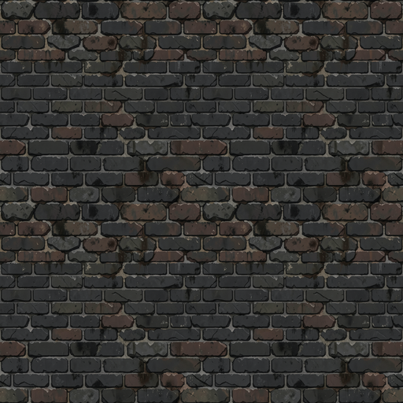 | `brick_1001` (seed 1001, 1024 px, 8-bit) | Dark soot-blackened red brick in running bond: city walls, chimneys, the kitchen yard. | no |
| 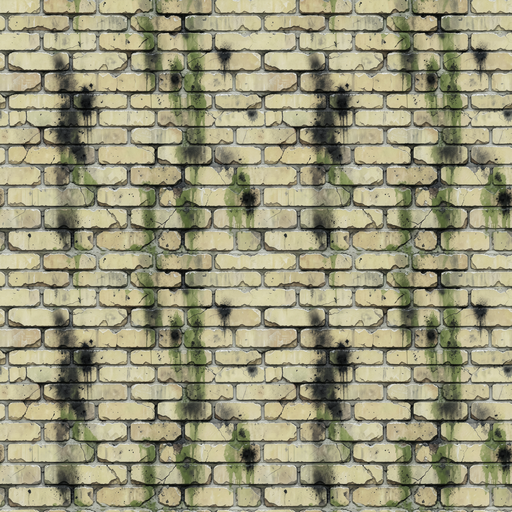 | `brick_1002` (seed 1002, 1024 px, 8-bit) | Pale brick with green damp streaks: a damp lane wall or a cellar; strong pattern, use on small areas. | no |

## ceramic_tiles

| preview | variant | note | in the game |
|---|---|---|---|
| 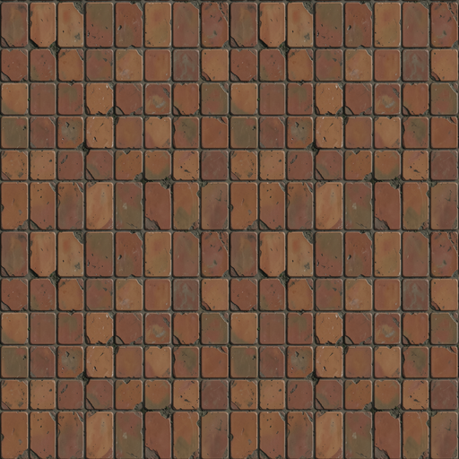 | `ceramic_tiles_1000` (seed 1000, 1024 px, 8-bit) | Small terracotta tiles: the kitchen floor. | no |
| 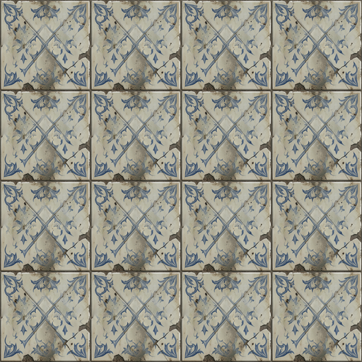 | `ceramic_tiles_1002` (seed 1002, 1024 px, 8-bit) | Pale tiles with blue painted patterns: the bathrooms. | no |

## cobblestone

| preview | variant | note | in the game |
|---|---|---|---|
| 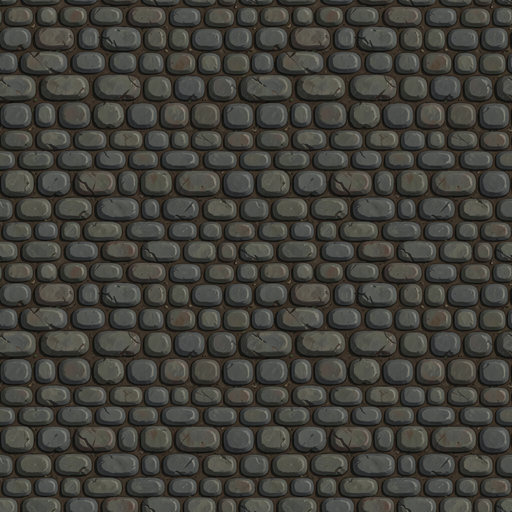 | `cobblestone_1000` (seed 1000, 1024 px, 8-bit) | Rounded grey cobbles in regular, brick-like rows: a town street or a market square. | no |
|  | `cobblestone_1001` (seed 1001, 1024 px, 8-bit) | Dark granite setts, mud and grit in the gaps: corridors, courtyards, stable yards. | `Textures/Cobblestone` |
|  | `cobblestone_1002` (seed 1002, 1024 px, 8-bit) | Brownish cobbles with moss and soil between them; its big stones repeat visibly, so best on small or broken-up areas: overgrown paths, ruins. | no |

## dressed_stone

| preview | variant | note | in the game |
|---|---|---|---|
| 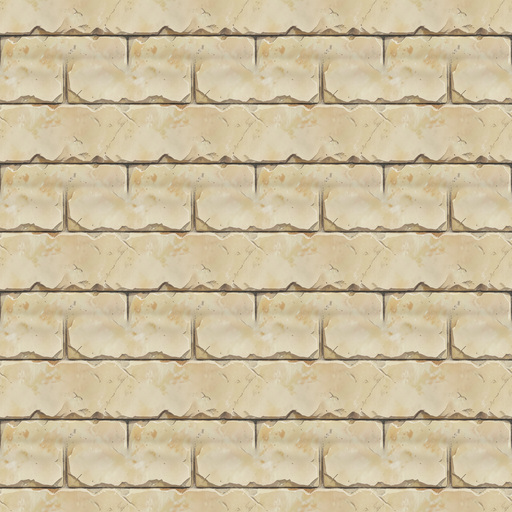 | `dressed_stone_1000` (seed 1000, 1024 px, 8-bit) | Cream sandstone ashlar in even courses: the church's walls, the manor's facade. | no |

## grass

| preview | variant | note | in the game |
|---|---|---|---|
| 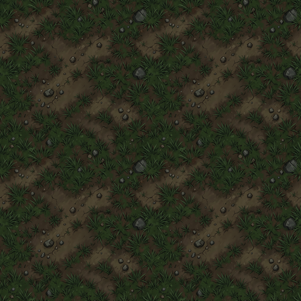 | `grass_1000` (seed 1000, 1024 px, 8-bit) | Dark green grass with bare soil: the grounds, the churchyard. | no |
| 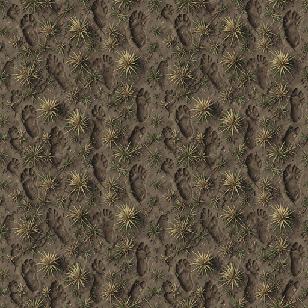 | `grass_1001` (seed 1001, 1024 px, 8-bit) | Trampled dry grass with footprints: the vineyard's paths between rows. | no |
| 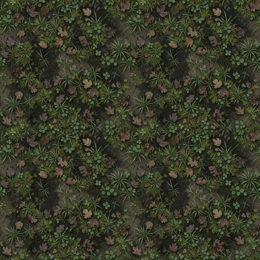 | `grass_1002` (seed 1002, 1024 px, 8-bit) | Overgrown grass with clover and leaves: the churchyard, neglected corners. | no |

## ground

| preview | variant | note | in the game |
|---|---|---|---|
| 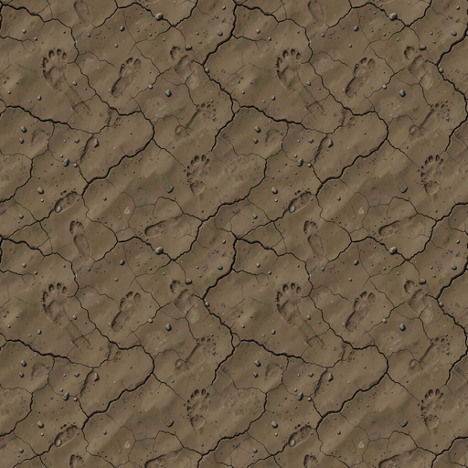 | `ground_1000` (seed 1000, 1024 px, 8-bit) | Dry beaten earth with cracks, pebbles and footprints: paths, yards, a cellar floor. | `Textures/Ground` |
| 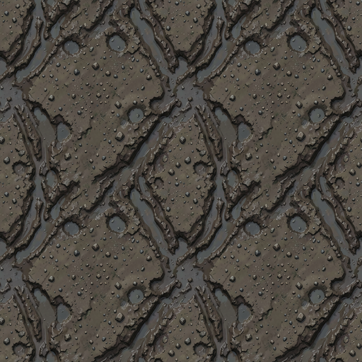 | `ground_1001` (seed 1001, 1024 px, 8-bit) | Dark mud with ruts and small puddles; the ruts form a visible diamond when tiled, so best on narrow strips: lanes, stable yards (tiles after the masking fallback). | no |
| 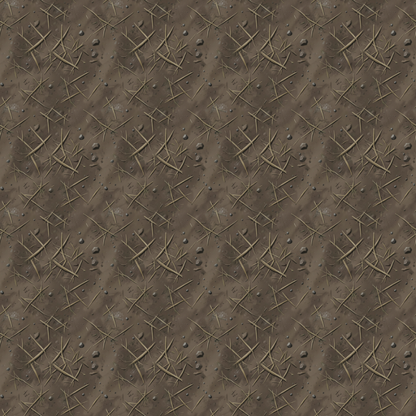 | `ground_1002` (seed 1002, 1024 px, 8-bit) | Earth with scattered straw; the image repeats itself inside the tile (2x2), so it reads finer than it is: stables, barns. | no |

## metal

| preview | variant | note | in the game |
|---|---|---|---|
| 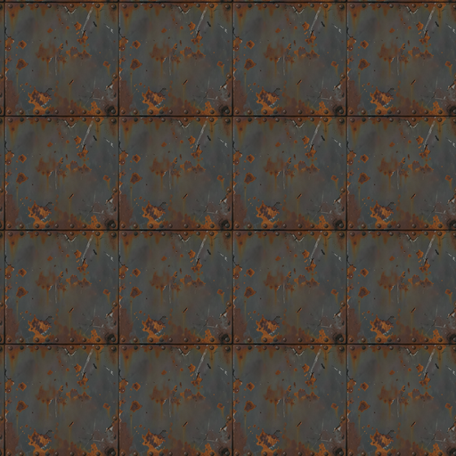 | `metal_1000` (seed 1000, 1024 px, 8-bit) | Rusted dark iron sheets with rivets (tiles after the masking fallback): doors, strongboxes, gates, machinery. | `Textures/Metal` |
| 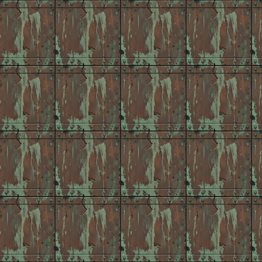 | `metal_1001` (seed 1001, 1024 px, 8-bit) | Riveted copper sheets with green verdigris streaks (tiles after the masking fallback): roofs of rich houses, gutters, boilers. | no |
| 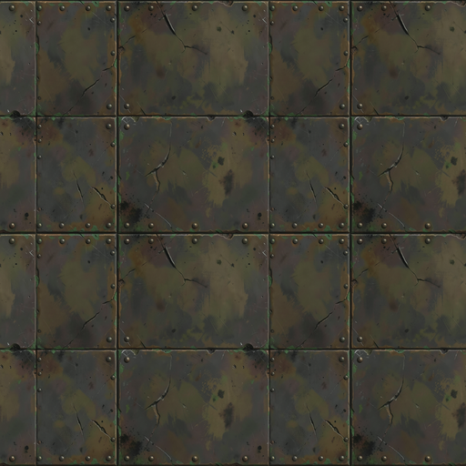 | `metal_1002` (seed 1002, 1024 px, 8-bit) | Tarnished dark brass plates with rivets and cracks. FAILS the seam test: regenerate before use. | no |
| 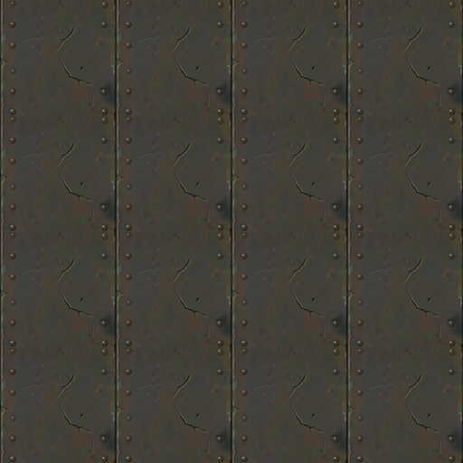 | `metal_2002` (seed 2002, 1024 px, 8-bit) | Dark tarnished brass in vertical riveted strips; FAILS the seam test after the masking fallback and the strip repeats four times inside the tile: regenerate before use. | no |

## ossuary

| preview | variant | note | in the game |
|---|---|---|---|
| 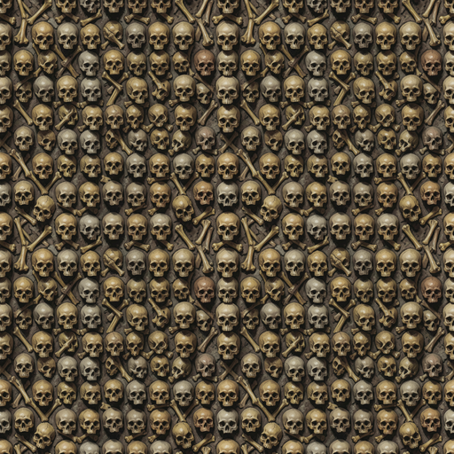 | `ossuary_1001` (seed 1001, 1024 px, 8-bit) | A dense wall of skulls with bones: the ossuary's walls. | no |
| 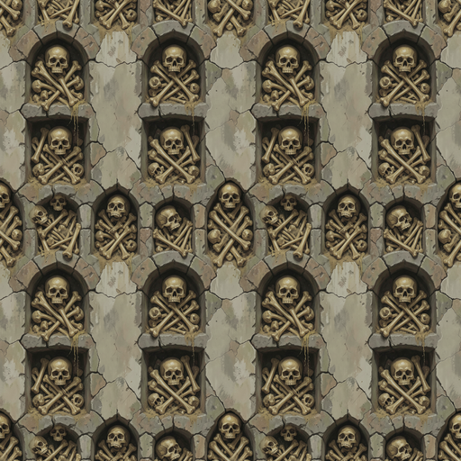 | `ossuary_2002` (seed 2002, 1024 px, 8-bit) | Plaster wall with niches of skulls and crossed bones, a regular decorative repeat: small panels only. | no |

## planks

| preview | variant | note | in the game |
|---|---|---|---|
| 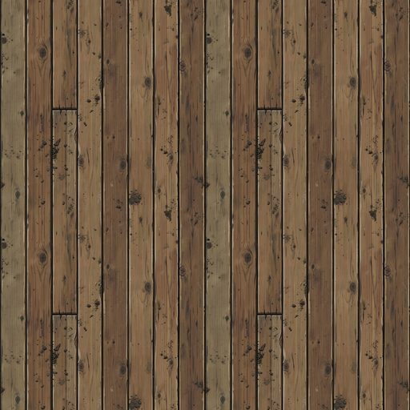 | `planks_1000` (seed 1000, 1024 px, 8-bit) | Warm brown oak floor boards with knots and dark wear marks, a few short joints: house floors, upper storeys, attics. | `Textures/Planks` |
| 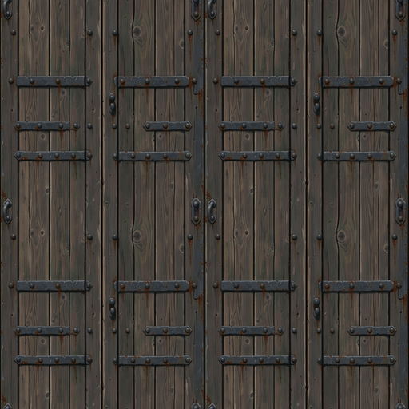 | `planks_1001` (seed 1001, 1024 px, 8-bit) | Dark planks held by riveted iron bands, two door leaves side by side: doors, gates, strong-room walls; the bands repeat visibly on large areas. | no |
| 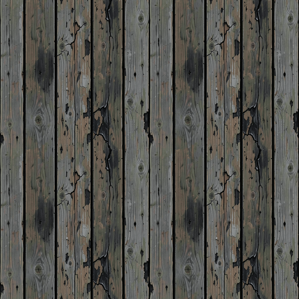 | `planks_1002` (seed 1002, 1024 px, 8-bit) | Grey weathered boards with tar stains and flaking black paint: sheds, stables, outbuilding walls, the outskirts. | `Textures/Planks` |

## plaster

| preview | variant | note | in the game |
|---|---|---|---|
| 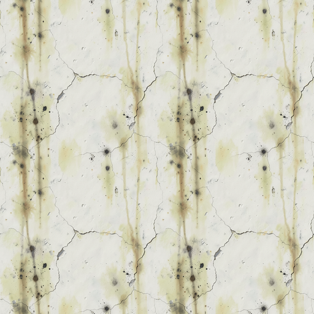 | `plaster_1000` (seed 1000, 1024 px, 8-bit) | Off-white lime plaster with fine cracks, damp streaks and soot spots: interior walls of houses and the cloister. | `Textures/Plaster` |
| 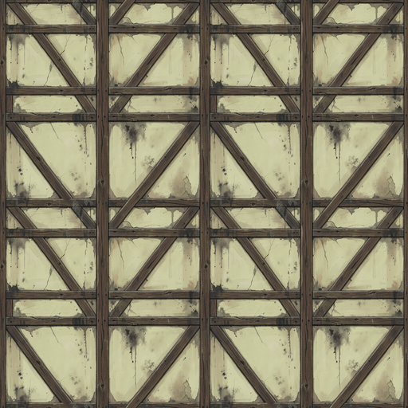 | `plaster_1001` (seed 1001, 1024 px, 8-bit) | Half-timbered panels: dark beams with diagonal braces over cream plaster. Town house fronts; the frame sets the wall's scale (about 2 m per tile). | `Textures/Plaster` |
| 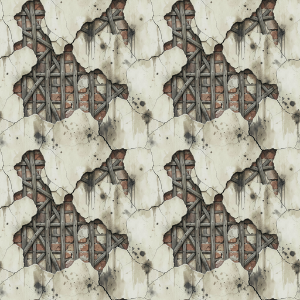 | `plaster_1002` (seed 1002, 1024 px, 8-bit) | Plaster flaking off over wattle and brick; the one big hole repeats visibly, so best on small or broken-up areas: ruins, poor houses, cellars. | no |

## polished_wood

| preview | variant | note | in the game |
|---|---|---|---|
| 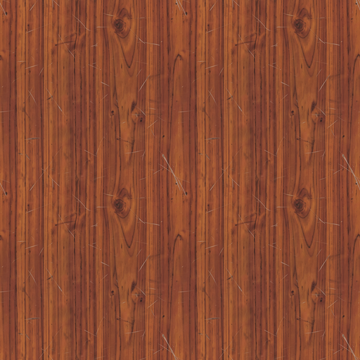 | `polished_wood_1001` (seed 1001, 1024 px, 8-bit) | Reddish cherry with grain: furniture; also reads as floorboards. | no |
| 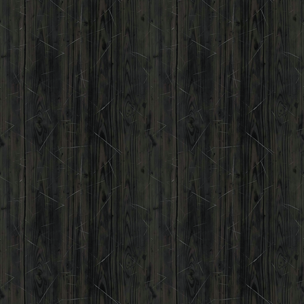 | `polished_wood_1002` (seed 1002, 1024 px, 8-bit) | Near-black ebonised wood: furniture (the desk, the bookcases). | no |

## rock

| preview | variant | note | in the game |
|---|---|---|---|
| 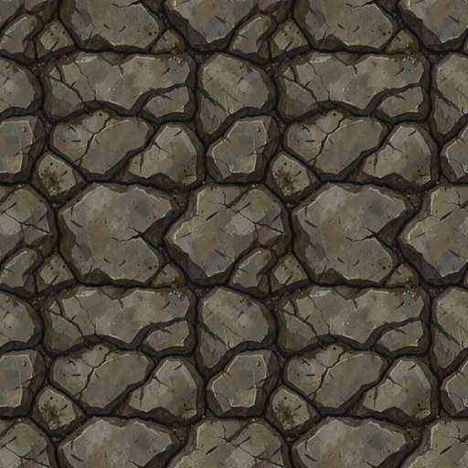 | `rock_1000` (seed 1000, 1024 px, 8-bit) | Grey-brown cracked rock: reads as a rough floor or a cave floor more than a wall. | no |
| 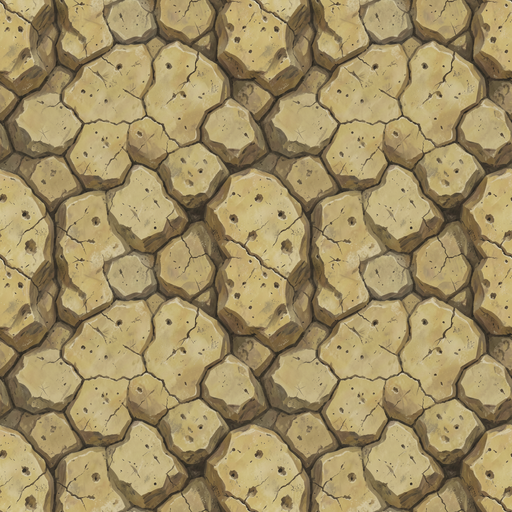 | `rock_1001` (seed 1001, 1024 px, 8-bit) | Yellow tuff with holes, cracked: catacomb floor or a soft carved wall. | no |
| 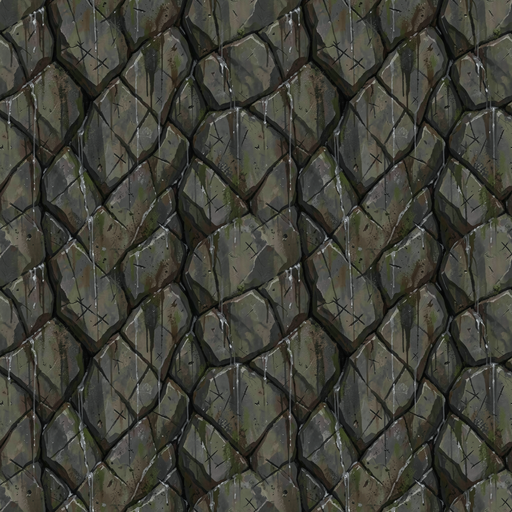 | `rock_1002` (seed 1002, 1024 px, 8-bit) | Dark wet rock with mineral streaks: the catacombs' and the collapsed tunnel's walls. | no |

## roof_tiles

| preview | variant | note | in the game |
|---|---|---|---|
| 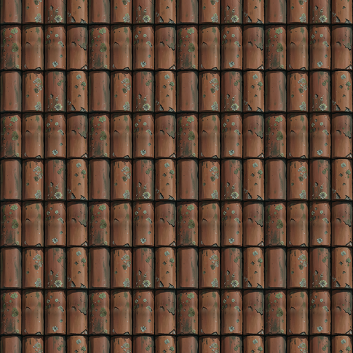 | `roof_tiles_1000` (seed 1000, 1024 px, 8-bit) | Faded terracotta clay tiles with lichen: warmer roofs, a town or southern look (tiles after the masking fallback). | no |
|  | `roof_tiles_1001` (seed 1001, 1024 px, 8-bit) | Dark grey slate, mossy at the edges (tiles after the masking fallback). Reads as the walls' stone, not as roofing (owner, 2026-11-20): not for roofs; maybe flagstones or wall cladding. | no |
|  | `roof_tiles_1002` (seed 1002, 1024 px, 8-bit) | Weathered silver-grey wooden shingles: sheds, stables, poor houses. FAILS the seam test (a line across the middle): fix or regenerate before use. | no |
| 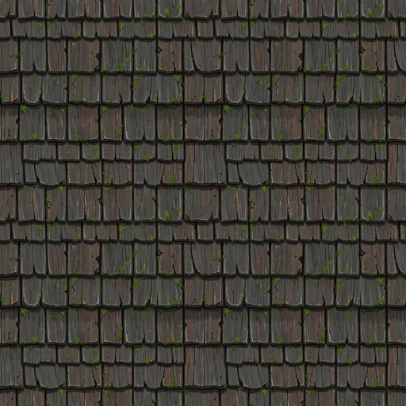 | `roof_tiles_1003` (seed 1003, 1024 px, 8-bit) | Dark weathered wooden shingles with moss in the gaps: roofs of houses, sheds and the cloister's corridors. | `Textures/Roof` |
| 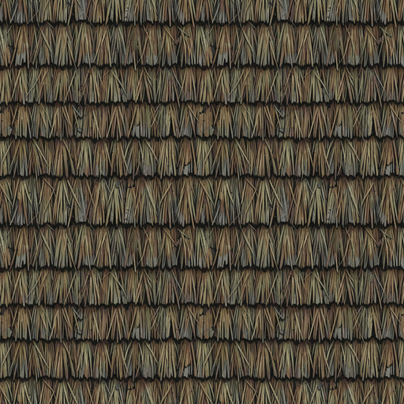 | `roof_tiles_1004` (seed 1004, 1024 px, 8-bit) | Old thatch of straw and reeds: poor houses, barns, the outskirts. FAILS the seam test (a faint line): fix or regenerate before use. | no |
| 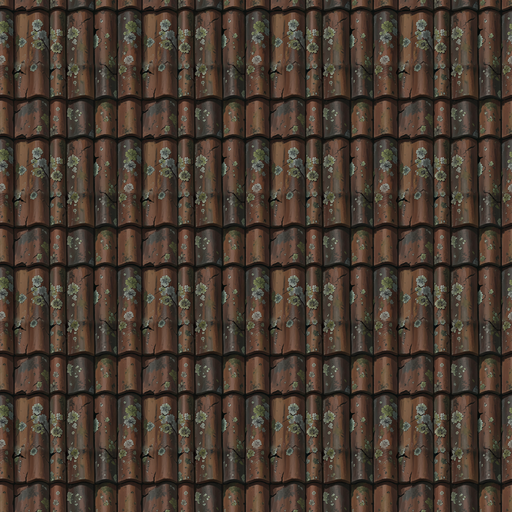 | `roof_tiles_1005` (seed 1005, 1024 px, 8-bit) | Fired clay roof tiles, dark brown and ochre, lichen: richer town houses. FAILS the seam test even after the masking fallback (soft detail at the centre): regenerate before use. | no |
| 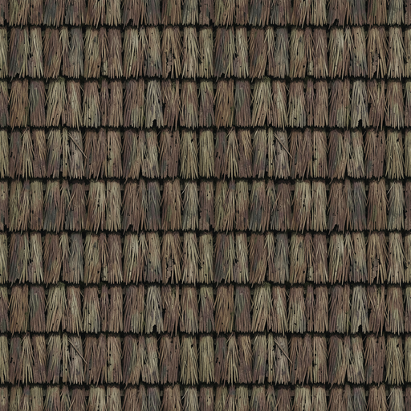 | `roof_tiles_3001` (seed 3001, 1024 px, 8-bit) | Old thatch in overlapping straw bundles, brown and darkened: poor houses, barns, the outskirts. | `Textures/Roof` |
| 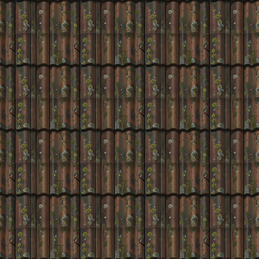 | `roof_tiles_3002` (seed 3002, 1024 px, 8-bit) | Rust-brown curved clay tiles with lichen; FAILS the seam test after the masking fallback (a soft band across the middle) and the lichen repeats visibly: regenerate before use. | no |

## rug

| preview | variant | note | in the game |
|---|---|---|---|
| 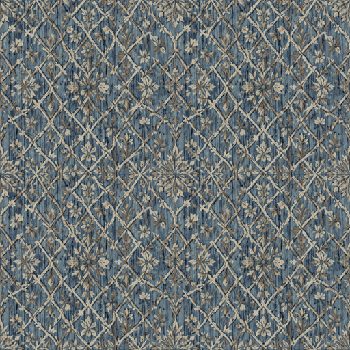 | `rug_1001` (seed 1001, 1024 px, 8-bit) | Faded blue and cream floral rug: the bedroom, the library. | no |
| 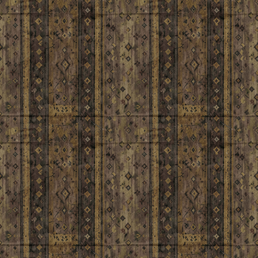 | `rug_1002` (seed 1002, 1024 px, 8-bit) | Brown and ochre striped rug: the hall, the servants' rooms. | no |
| 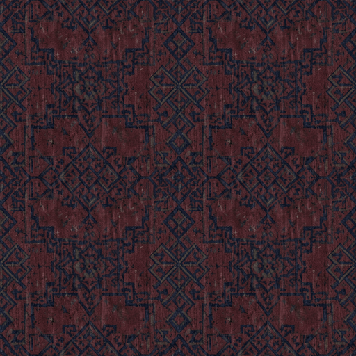 | `rug_2000` (seed 2000, 1024 px, 8-bit) | Deep red rug with dark blue medallions: the drawing room. | no |

## stone_floor

| preview | variant | note | in the game |
|---|---|---|---|
| 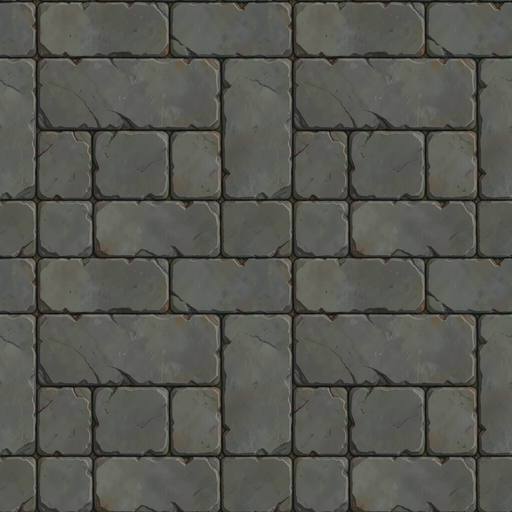 | `stone_floor_1000` (seed 1000, 1024 px, 8-bit) | Grey rectangular flagstones of mixed sizes with dark joints: halls, the cloister, cellars. | `Textures/StoneFloor` |
| 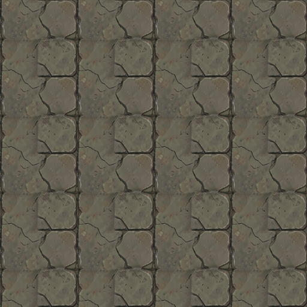 | `stone_floor_1001` (seed 1001, 1024 px, 8-bit) | Worn sandstone flags. FAILS the seam test even after the masking fallback, and the masking left a soft square at the centre: regenerate before use. | no |
| 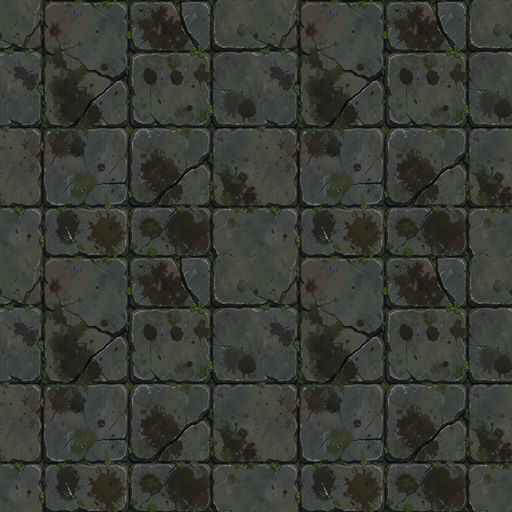 | `stone_floor_1002` (seed 1002, 1024 px, 8-bit) | Dark wet flagstones with grass and black puddle stains in the joints: courtyards, wet cellars. FAILS the seam test (a faint line): regenerate before use. | no |
| 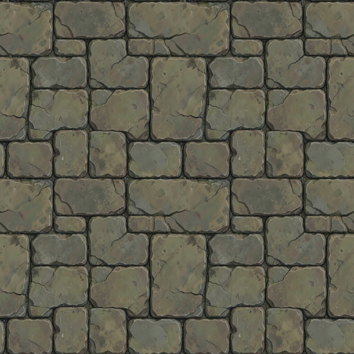 | `stone_floor_2001` (seed 2001, 1024 px, 8-bit) | Worn olive-grey sandstone flags of mixed sizes, cracked: halls, the cloister's walks, old cellars. | no |
| 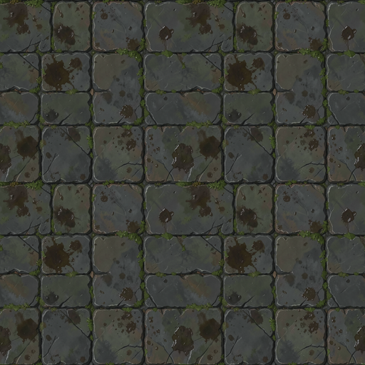 | `stone_floor_2002` (seed 2002, 1024 px, 8-bit) | Dark wet flags with grass in the joints and black puddle stains: courtyards, wet cellars, the yard by a well. | `Textures/StoneFloor` |

## stone_wall

| preview | variant | note | in the game |
|---|---|---|---|
|  | `stone_wall_1000` (seed 1000, 1024 px, 8-bit) | Light grey limestone in uneven courses, soot in the joints: garden and courtyard walls. | `Textures/StoneWall` |
| 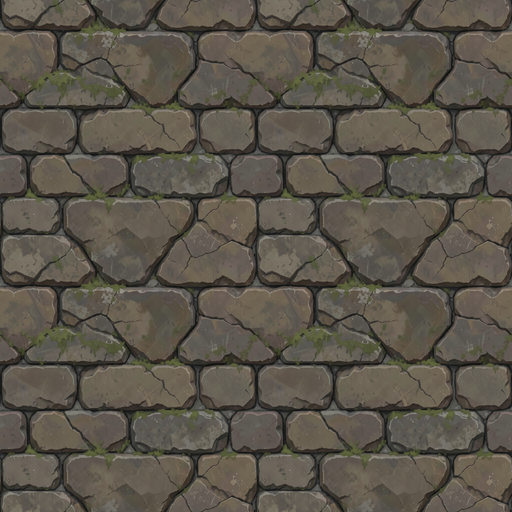 | `stone_wall_1001` (seed 1001, 1024 px, 8-bit) | Brown-grey sandstone, blocks of mixed sizes, moss low in the joints: older walls, ruins, cellars, outbuildings. | no |
|  | `stone_wall_1002` (seed 1002, 1024 px, 8-bit) | Dark cold granite with damp stains running down: outer walls, dungeons, wet places. | `Textures/StoneWall` |

## wallpaper

| preview | variant | note | in the game |
|---|---|---|---|
| 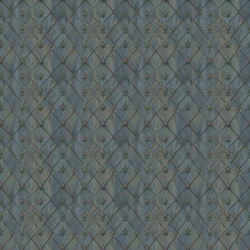 | `wallpaper_2002` (seed 2002, 1024 px, 8-bit) | Faded blue-grey hanging with lilies in a diamond grid: the bedroom, the guest room. | no |

## wood_ceiling

| preview | variant | note | in the game |
|---|---|---|---|
|  | `wood_ceiling_1000` (seed 1000, 1024 px, 8-bit) | Dark oak planks in a grid of square beams (coffered): halls, chapels. FAILS the seam test along the beams: fix or regenerate before use. | no |
|  | `wood_ceiling_1001` (seed 1001, 1024 px, 8-bit) | Narrow weathered pine boards with rows of nails (tiles after the masking fallback): plank walls, doors, sheds, floors. | no |
| 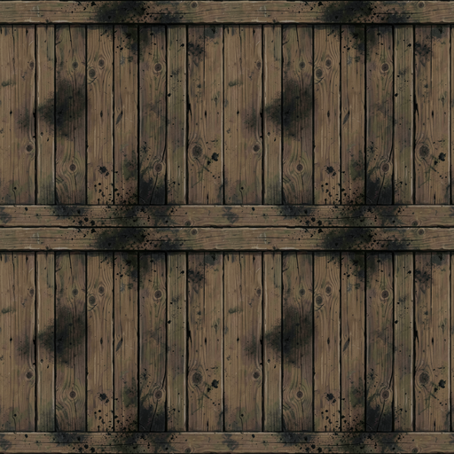 | `wood_ceiling_1002` (seed 1002, 1024 px, 8-bit) | Smoke-darkened planks crossed by heavy beams: corridor and cellar ceilings, the cloister's. | `Textures/Roof` |

## wood_panel

| preview | variant | note | in the game |
|---|---|---|---|
| 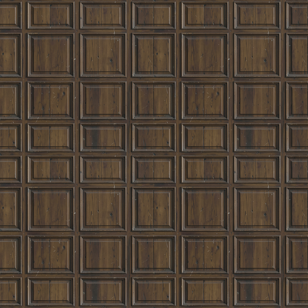 | `wood_panel_1000` (seed 1000, 1024 px, 8-bit) | Dark oak raised panels in a small grid: the library, the study. | no |
| 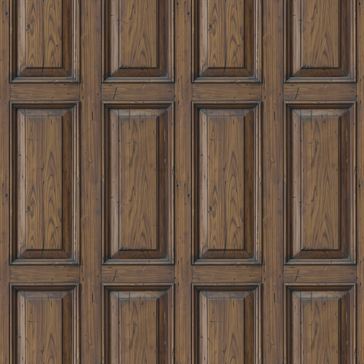 | `wood_panel_1001` (seed 1001, 1024 px, 8-bit) | Walnut panels in tall frames: the drawing room, the hall. | no |
| 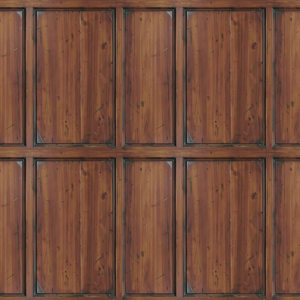 | `wood_panel_1002` (seed 1002, 1024 px, 8-bit) | Reddish wide panels: the dining hall, the bedroom. | no |
