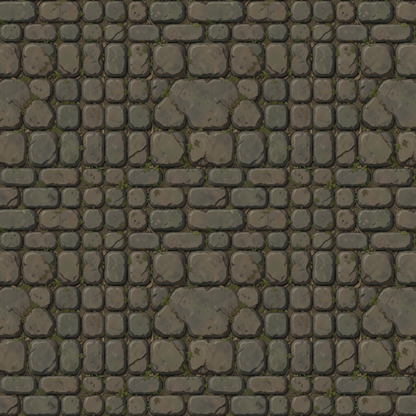
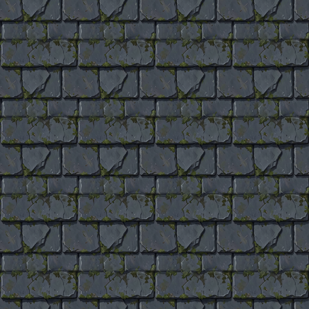
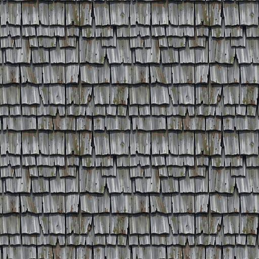
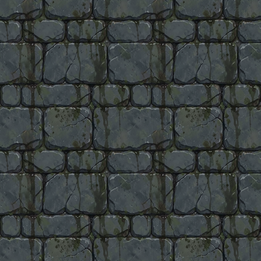
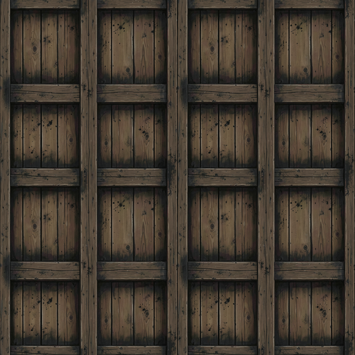
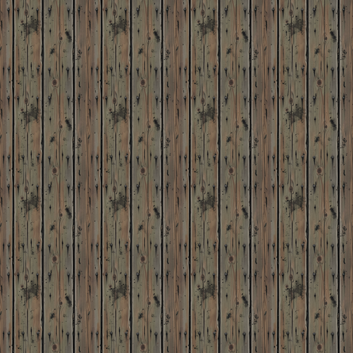

# Texture catalog

Every generated variant worth keeping, chosen or not: its provenance `.json` (prompt, seed, model revision,
settings, seam test) and a 2x2 preview at 512 px. The full maps (albedo, normal, metallic/roughness) are
not stored here; they come back from the `.json` on the Mac (about 4 minutes, Tools/AssetGen/README.md):

```sh
Tools/AssetGen/.venv/bin/python Tools/AssetGen/generate.py --from docs/art/textures/catalog/<material>/<name>.json
```

Generated by `Tools/AssetGen/catalog.py index`; do not edit by hand. Add a variant with
`catalog.py add <out>/<material>/<name>.json --note "..."`.

## cobblestone

| preview | variant | note | in the game |
|---|---|---|---|
|  | `cobblestone_1000` (seed 1000, 1024 px, 8-bit) | Rounded grey cobbles in regular, brick-like rows: a town street or a market square. | no |
|  | `cobblestone_1001` (seed 1001, 1024 px, 8-bit) | Dark granite setts, mud and grit in the gaps: corridors, courtyards, stable yards. | `Textures/Cobblestone` |
|  | `cobblestone_1002` (seed 1002, 1024 px, 8-bit) | Brownish cobbles with moss and soil between them; its big stones repeat visibly, so best on small or broken-up areas: overgrown paths, ruins. | no |

## roof_tiles

| preview | variant | note | in the game |
|---|---|---|---|
|  | `roof_tiles_1000` (seed 1000, 1024 px, 8-bit) | Faded terracotta clay tiles with lichen: warmer roofs, a town or southern look (tiles after the masking fallback). | no |
|  | `roof_tiles_1001` (seed 1001, 1024 px, 8-bit) | Dark grey slate, mossy at the edges (tiles after the masking fallback). Reads as the walls' stone, not as roofing (owner, 2026-11-20): not for roofs; maybe flagstones or wall cladding. | no |
|  | `roof_tiles_1002` (seed 1002, 1024 px, 8-bit) | Weathered silver-grey wooden shingles: sheds, stables, poor houses. FAILS the seam test (a line across the middle): fix or regenerate before use. | no |
|  | `roof_tiles_1003` (seed 1003, 1024 px, 8-bit) | Dark weathered wooden shingles with moss in the gaps: roofs of houses, sheds and the cloister's corridors. | `Textures/Roof` |
|  | `roof_tiles_1004` (seed 1004, 1024 px, 8-bit) | Old thatch of straw and reeds: poor houses, barns, the outskirts. FAILS the seam test (a faint line): fix or regenerate before use. | no |
|  | `roof_tiles_1005` (seed 1005, 1024 px, 8-bit) | Fired clay roof tiles, dark brown and ochre, lichen: richer town houses. FAILS the seam test even after the masking fallback (soft detail at the centre): regenerate before use. | no |

## stone_wall

| preview | variant | note | in the game |
|---|---|---|---|
|  | `stone_wall_1000` (seed 1000, 1024 px, 8-bit) | Light grey limestone in uneven courses, soot in the joints: garden and courtyard walls. | `Textures/StoneWall` |
|  | `stone_wall_1001` (seed 1001, 1024 px, 8-bit) | Brown-grey sandstone, blocks of mixed sizes, moss low in the joints: older walls, ruins, cellars, outbuildings. | no |
|  | `stone_wall_1002` (seed 1002, 1024 px, 8-bit) | Dark cold granite with damp stains running down: outer walls, dungeons, wet places. | `Textures/StoneWall` |

## wood_ceiling

| preview | variant | note | in the game |
|---|---|---|---|
|  | `wood_ceiling_1000` (seed 1000, 1024 px, 8-bit) | Dark oak planks in a grid of square beams (coffered): halls, chapels. FAILS the seam test along the beams: fix or regenerate before use. | no |
|  | `wood_ceiling_1001` (seed 1001, 1024 px, 8-bit) | Narrow weathered pine boards with rows of nails (tiles after the masking fallback): plank walls, doors, sheds, floors. | no |
|  | `wood_ceiling_1002` (seed 1002, 1024 px, 8-bit) | Smoke-darkened planks crossed by heavy beams: corridor and cellar ceilings, the cloister's. | `Textures/Roof` |
