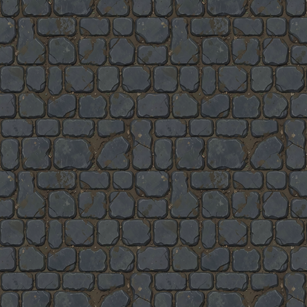
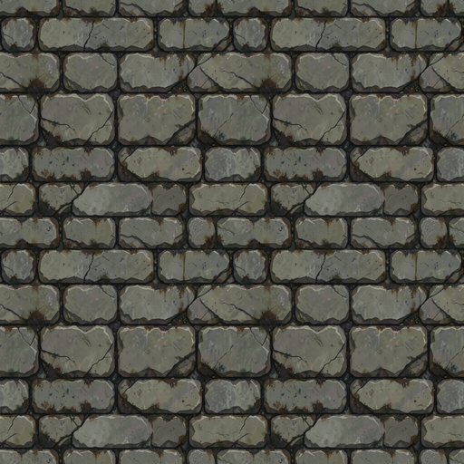

# Texture catalog

Every generated variant worth keeping, chosen or not: its provenance `.json` (prompt, seed, model revision,
settings, seam test) and a 2x2 preview at 512 px. The full maps (albedo, normal, metallic/roughness) are
not stored here; they come back from the `.json` on the Mac (about 4 minutes, Tools/AssetGen/README.md):

```sh
Tools/AssetGen/.venv/bin/python Tools/AssetGen/generate.py --from docs/art/textures/catalog/<material>/<name>.json
```

Generated by `Tools/AssetGen/catalog.py index`; do not edit by hand. Add a variant with
`catalog.py add <out>/<material>/<name>.json --note "..."`.

## cobblestone

| preview | variant | note | in the game |
|---|---|---|---|
|  | `cobblestone_1000` (seed 1000, 1024 px, 8-bit) | Rounded grey cobbles in regular, brick-like rows: a town street or a market square. | no |
|  | `cobblestone_1001` (seed 1001, 1024 px, 8-bit) | Dark granite setts, mud and grit in the gaps: corridors, courtyards, stable yards. | `Textures/Cobblestone` |
|  | `cobblestone_1002` (seed 1002, 1024 px, 8-bit) | Brownish cobbles with moss and soil between them; its big stones repeat visibly, so best on small or broken-up areas: overgrown paths, ruins. | no |

## stone_wall

| preview | variant | note | in the game |
|---|---|---|---|
|  | `stone_wall_1000` (seed 1000, 1024 px, 8-bit) | Light grey limestone in uneven courses, soot in the joints: garden and courtyard walls. | `Textures/StoneWall` |
|  | `stone_wall_1001` (seed 1001, 1024 px, 8-bit) | Brown-grey sandstone, blocks of mixed sizes, moss low in the joints: older walls, ruins, cellars, outbuildings. | no |
|  | `stone_wall_1002` (seed 1002, 1024 px, 8-bit) | Dark cold granite with damp stains running down: outer walls, dungeons, wet places. | `Textures/StoneWall` |
