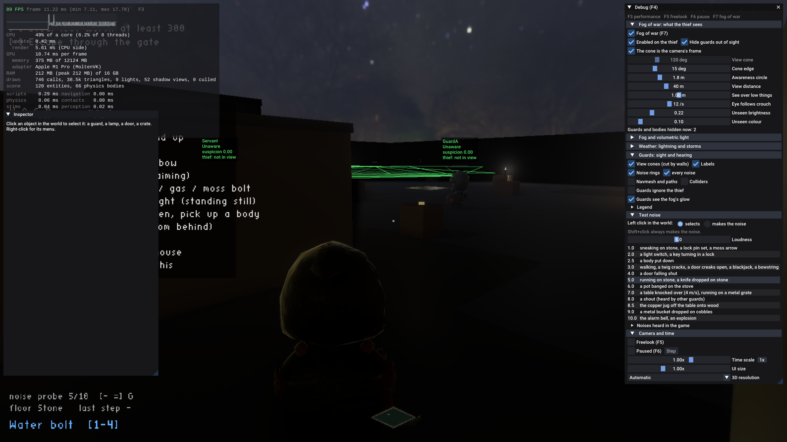
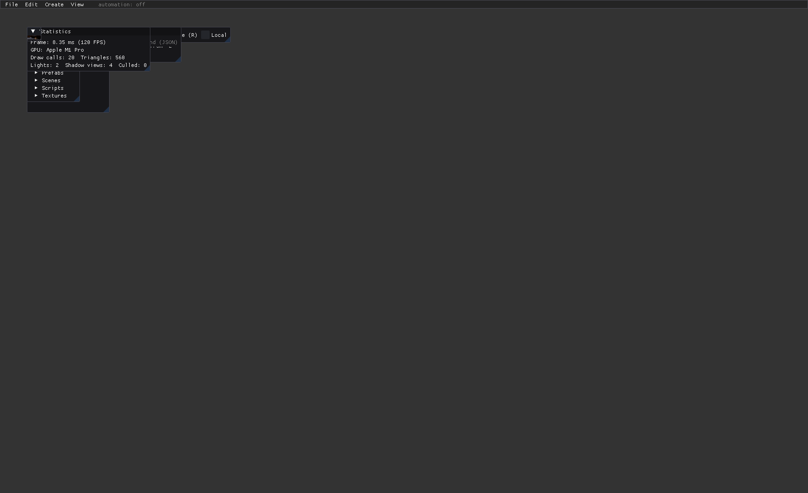
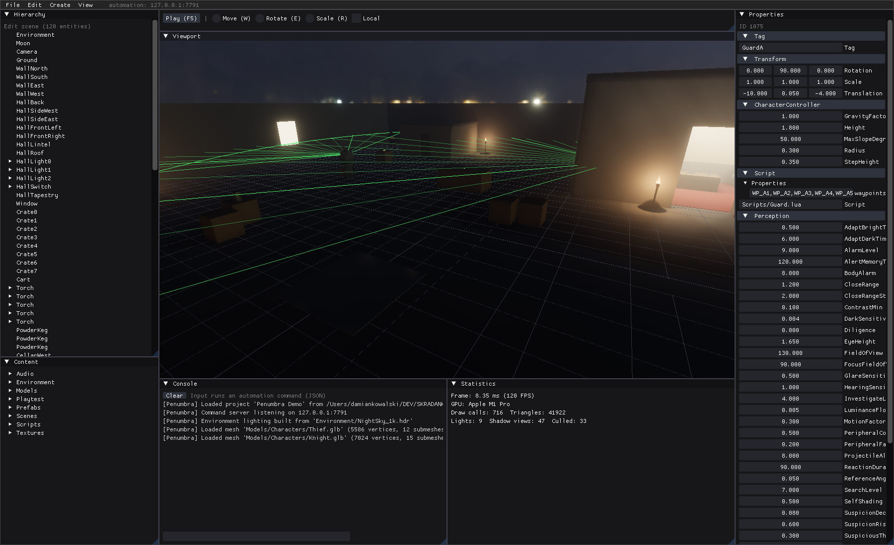
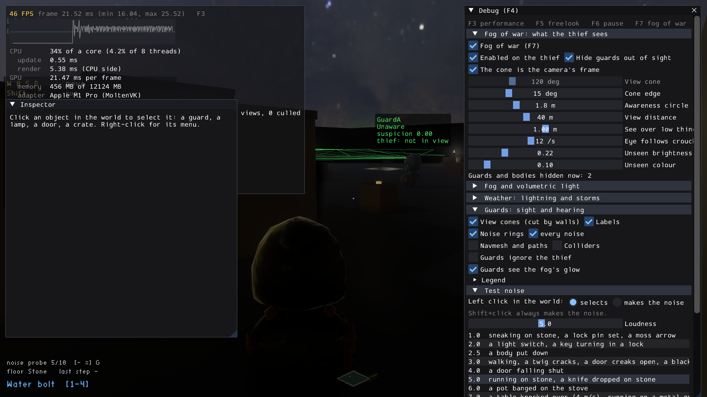

# Developer tools' UI: survey and brief

Status: **approved 2026-11-24** with the proposed answers: fonts (a) Roboto + Cousine from the pinned ImGui,
order A → B → C → D, F4 as tabs, today's palette stays. The Roadmap's "Developer tools' UI" package (M-L, approved
2026-11-23) started from this survey; part A is the first PR.

**Part A after** (Retina, Roboto + Cousine; the panels placed as in "Panels placed by hand" through a scratch
`PENUMBRA_USER_DIR`). The editor's layout and Properties are parts B and C.

| Runtime, F3 + F4 | Editor |
|---|---|
|  |  |

## How the pictures were taken

`--screenshot` saves only the scene renderer's output, so it never showed the UI. A new switch,
`--window-screenshot <file.png>`, saves the window's last frame as it is shown, UI included (editor and runtime,
windowed runs with `--frames`). On a Mac M1 Pro, Vulkan through MoltenVK:

```sh
PenumbraRuntime --project DemoProject --scene Scenes/Stealth.pscene --frames 150 --debug-ui performance,panel --window-screenshot runtime_f3_f4.png
PenumbraEditor --project DemoProject --no-server --frames 150 --window-screenshot editor.png   # run from an empty folder
```

The pictures are in logical pixels (the window draws at 1x, see "Shared"). They don't show the Retina blur;
a real Retina screen shows the same picture scaled up 2x.

## What we have

### Editor

| First start, no saved layout | Panels placed by hand, Stealth open, GuardA selected |
|---|---|
|  |  |

1. **No default layout.** On a first start every panel is stacked in the top-left corner, and the viewport is
   32x32 px. The layout file `PenumbraEditor.ini` is written to whatever folder the editor was started from,
   so a start from another folder looks like the first start again.
2. **The toolbar is a separate panel** (Play, Move/Rotate/Scale, Local) and takes a whole row. **Statistics**
   takes a quarter of the bottom for four lines.
3. **Properties cut their labels**: `GravityFacto`, `MaxSlopeDegr`, `AdaptBrightT`, `CloseRangeSt`. The value
   takes about 70% of the width and the label sits on the right (ImGui's default). Perception alone has about 30
   fields in one list, with no groups, units or tooltips. Transform shows Rotation, Scale, Translation in that
   order, and its X/Y/Z fields have no axis colours or labels.
4. **Hierarchy**: a flat list of 120 names with no search. There are five entities called `Torch`, and no icon or
   hint of what an entity is (light, guard, prop). It already has a right-click menu (Duplicate, Unparent, Save
   as Prefab, Delete), but not on empty space (create here). There is no rename in place.
5. **Content** is a folder tree only: no file list next to it, no previews, no right-click menu.
6. **Console**: plain lines, no colours per level and no filter.
7. **No UI size setting** (the runtime has one).

### Runtime testing tools (F3-F7)



1. **Panels overlap.** The Inspector opens on top of the F3 performance panel and hides half of it. The
   on-screen hints (`W A S D`, `Shift`) show through behind F3.
2. **F4 is one long column** about a third of the screen wide: fog of war, fog, weather, guards, test noise and
   the noise legend, one under another. Labels are cut here too (`See over low thin`, `Eye follows crouc`), and
   so is the end of the noise table (`a black`).
3. **Nothing is remembered.** F4 and the Inspector come back at their default place and size every start (the
   runtime has no layout file).
4. The Inspector is a large window that is mostly empty until something is selected.
5. Good: the UI size follows the window height and has a slider (`UI size`), and the overlays read well.

### Shared

1. **Blur on Retina.** The window is created without a Retina framebuffer (`GLFW_COCOA_RETINA_FRAMEBUFFER`
   off), so the game, the editor and their UI draw at half resolution and macOS scales them up. This was chosen
   on purpose, so that input, ImGui and the renderer use the same coordinates as on Windows.
2. **The font is ImGui's built-in bitmap font** (ProggyClean 13 px). Scaled up it gets blocky and soft. No TTF is
   loaded.
3. The style (a dark palette with a cold accent) lives in `ImGuiHost::ApplyStyle` and is shared, which is good.
   There are no icons.

## Proposal

Four parts, each its own PR, in this order. Each ends with `--window-screenshot` pictures before and after in
the PR.

**A. Sharpness and foundations (M)**
* A Retina framebuffer on macOS and per-monitor DPI on Windows. Window coordinates and framebuffer pixels
  become two different things, so these change with it: input and mouse picking, `ScreenRayDirection`, ImGuizmo,
  cursor lock, the viewport size and `render.screenshot` sizes. ImGui 1.92 (pinned) scales fonts per monitor by
  itself (`io.ConfigDpiScaleFonts`, `style.FontScaleDpi`).
* Real fonts: a proportional one for the UI and a monospace one for numbers, the console and the F3 table,
  sharp at every size (ImGui 1.92 rasterizes TTF fonts at the size they are used).
* One UI size setting for the editor and the runtime, and layout files in a fixed per-user place instead of the
  folder the program was started from.
* Tests: the window/framebuffer coordinate mapping (unit), picking at 2x (integration), `--window-screenshot`
  (fails cleanly without a window).

**B. Editor layout (M)**
* A default docked layout built on the first start, and **View → Reset layout**: Hierarchy on the left with
  Content under it, Properties on the right, Console and Statistics as tabs under the viewport.
* The toolbar moves into the top of the viewport (Play in the middle). Statistics become a small overlay in the
  viewport's corner, with the full table one click away.
* Every panel collapses, docks, tabs and remembers its place (docking is already on; this makes it the default).

**C. Editor panels (M)**
* Properties: labels on the left in a column that fits them, values on the right. A tooltip shows the full name and
  units. Transform reads Position, Rotation, Scale with coloured X/Y/Z. Long components (Perception, Light, Fog)
  get groups that come from the component registry, so the editor, Lua and docs stay one source of truth.
* Right-click menus: on a component header (reset, copy/paste values, remove), on a field (reset to default,
  copy), on empty Hierarchy space (create entity, create from prefab), in Content (open, create script, show
  in Finder/Explorer).
* Hierarchy: search, an icon per kind of entity, rename with F2 or a double click.
* Console: colours per level, a filter, copy a line.

**D. Runtime testing tools (S-M)**
* F4 becomes tabs (Fog of war, Fog and light, Weather, Guards, Noise) instead of one long column, and it is
  narrower.
* No overlaps: the Inspector docks under F4 or opens compact next to the selected object. F3 stays a compact
  corner overlay, and the hints move out from under it.
* The runtime remembers where its panels were (the same per-user file as in A).
* No cut labels: label width follows the longest label in a section.

Total: **M-L**, about 4 PRs. A comes first because B-D look different once the pixels are sharp.

### Risks

* **Retina (A) is the risky part.** Every place that turns a mouse position into the world (picking, gizmos, the
  noise probe, freelook) has to use the same scale, or clicks land beside the object. It is tested on both
  backends and on Windows (CI checks Windows, but per-monitor DPI needs the owner's eyes on a scaled Windows
  screen).
* The game renders 4x the pixels on a Retina screen. A render-scale setting (draw the 3D at 1x, the UI at 2x)
  keeps the frame rate where it is today; it is part of A.
* Docking layouts saved by an older build may look wrong once; Reset layout fixes them.

## Decisions (taken 2026-11-24: 1a, A → B → C → D, tabs, keep the palette)

1. **Fonts.** (a) Roboto + Cousine, which already come with the pinned ImGui (nothing to download); or
   (b) Inter + JetBrains Mono (OFL, sharper for UI and code, a one-time download into the repo, which you approve
   before it happens).
2. **Order.** A → B → C → D as above, or D (the runtime tools you use while playing) right after A.
3. **F4 in the runtime**: tabs (proposed) or panels that dock like the editor's.
4. **Look**: keep today's dark palette with the cold accent, or ask for a few variants on screenshots first.
