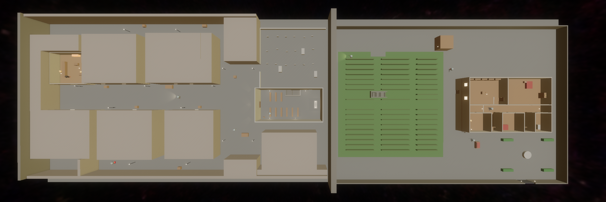
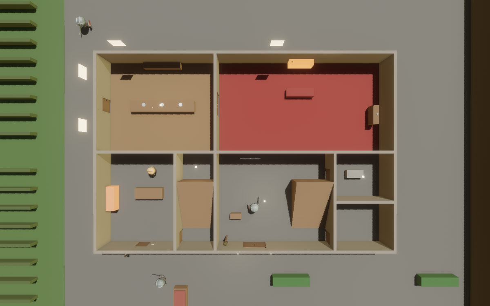
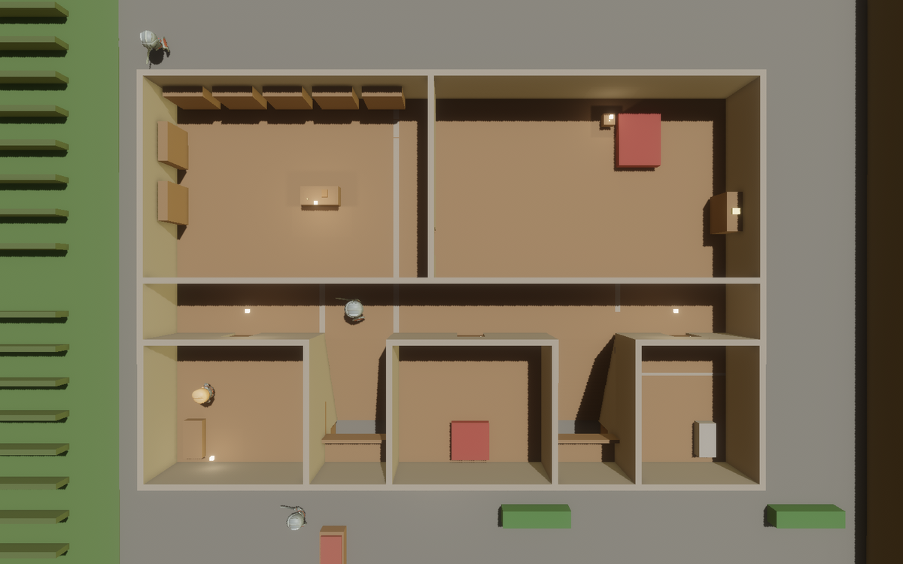
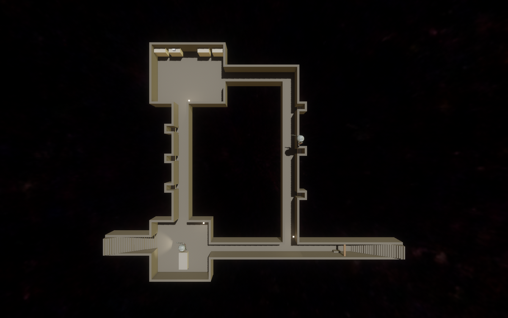
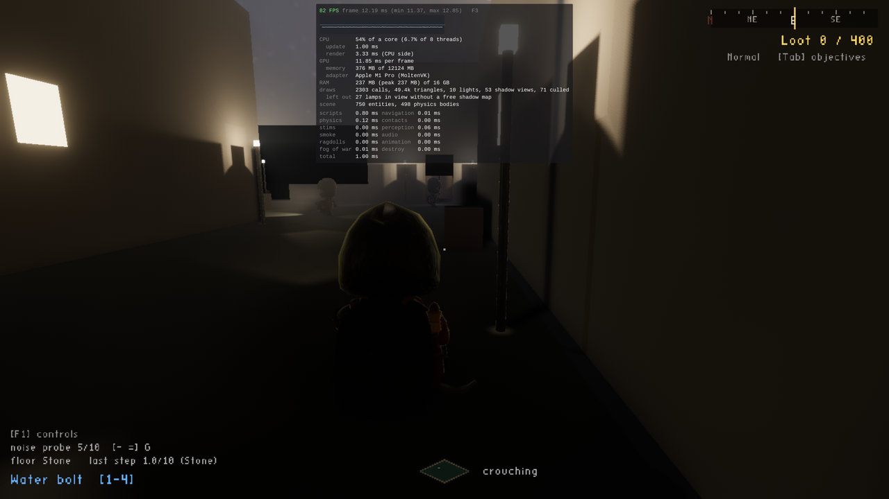
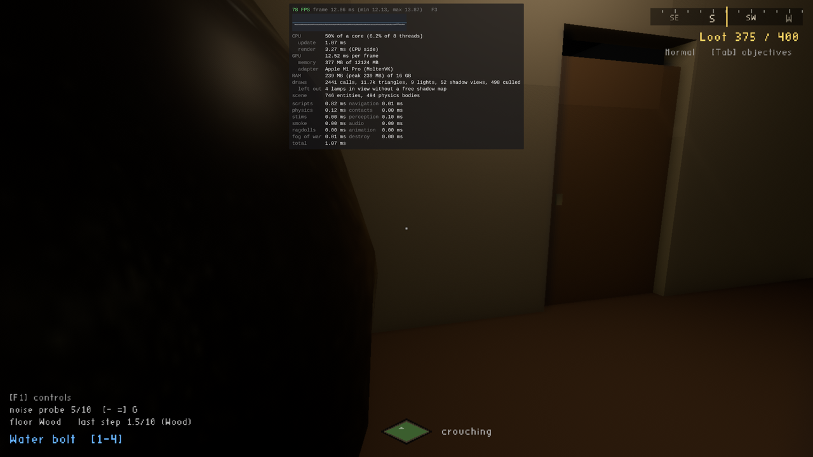

# The first mission: the blockout

Status: **done, 2026-11-27** (step 1 of the order in [`MissionOne.md`](MissionOne.md)). The whole route of the
first mission in grey boxes, playable with today's mechanics, walked by the agent playtester. It fixes the sizes,
the sightlines and the counts the engine packages are measured against; the art comes later, place by place.

* Scene `Scenes/Mission1.pscene`, generated by `build_mission1()` in `Tools/BuildDemoProject.py` (its floor-plan
  builder: rooms as rectangles on a 0.5 m grid, walls on every line between two rooms or a room and the outside,
  openings with lintels; slabs with holes; flights of solid steps).
* Mission `Scripts/Missions/Mission1.lua`; the menu offers it as the second mission (left / right).
* Playtester route `Playtest/Mission1/BackLanes`; tests in `PenumbraTests/src/MissionOneTests.cpp` and the
  `Scene.Mission1Demo` smoke test.

## The route, west to east

| Place | Size | What is there | Watched by |
|---|---|---|---|
| The tavern (start) | 14 x 12 m | Bar, tables, the hearth, the innkeeper and two patrons (standing figures until the townsfolk) | - |
| The old town | 110 x 60 m | A main street, a back lane and a south lane between blocks of houses, alleys, crates and barrels, lit windows, 15 street lanterns | 2 watchmen on loops round the blocks (one with a lantern), one in the south lane, one on the square |
| The square and the churchyard | 16 x 32 m, 27 x 24 m | The church's west door, the churchyard's gate, graves and tombs | the square's watchman |
| The church | 24 x 12 m, 11 m high | Pews, the altar, candles; the side door to the churchyard; the crypt stairs along the north wall | the sexton |
| The catacombs | about 65 m of passages | The crypt, a loop past niches with bones, the ossuary; floor at -4 m under the ground's slab | a watchman with a lantern on the loop |
| The collapsed tunnel | 12 m, then 25 steps up | Rubble, a fallen beam; it passes under the city wall and comes up in a ruined well house in the vineyard | - |
| The vineyard | 42 x 42 m | Rows of vines 1.4 m high (cover for a crouching thief), crossing paths, the press house | a watchman with a lantern round its edge, one on the manor's terrace |
| The manor, ground floor (4 m) | 30 x 20 m | Kitchen, dining hall (the feast's table), drawing room with the fireplace, hall with the grand stairs, the servants' stairs, bathroom, cloakroom | the hall guard (who also goes up), the scullion |
| The manor, first floor (4 m) | 30 x 20 m | Library, bedroom (locked, or through the library), bathroom, maid's room, guest room, the corridor | the upstairs guard, the maid |
| The kitchen yard and the forecourt | | The leftovers cart, its bell and Manuel's note (placeholders: the way out through the cart is its own package), the fountain, the gate (closed) | the yard guard |

The thief gets in through the garden door (locked: picked) or the kitchen door, and leaves the way he came: through
the vineyard into the tunnel, where the exit is (it says nothing when he first comes through it, `Goal.remind`).

| | |
|---|---|
|  |  |
| The ground floor: dining hall and drawing room (north), kitchen, the servants' stairs, the hall with the grand stairs, bathroom and cloakroom (south) | The first floor: library and bedroom (north), the maid's room, the guest room and the bathroom, the corridor between them and the two stairwells |

The catacombs: the crypt stairs come down at the bottom left, the loop goes up past the niches to the ossuary and
back down the east passage, the tunnel runs off east and climbs into the vineyard.

## The mission (provisional)

"The Mayor's Leftovers": the ledger from the library (an item objective), loot worth 400 / 700 / 1,000, the
signet ring from the bedroom on Hard and Expert, no killing on Expert, and the way out back into the tunnel. Loot:
18 pieces worth 1,775 (the church's silver, a ring and a reliquary in the catacombs, the feast's silver, the
drawing room's snuffbox and candelabrum, the bedroom's jewel box, the library's inkwell, three purses). The
ledger, the lord's title ("the mayor") and the name are placeholders until the owner decides them.

## What it holds

| | |
|---|---|
| Entities | 750 (590 meshes, 481 box colliders) |
| Lights | 44 point lights, all casting shadows (the renderer gives its 8 point shadow maps to the lamps reaching the view and leaves the rest of those in view out), and 3 guards' lanterns |
| People | 11 guards, 2 servants, 3 standing figures |
| Doors | 22 leaves, 3 of them locked |
| Navmesh | 949 polygons over 204 x 65 m and three levels (-4, 0 and 4 m), built in about 150 ms |
| Scene file | 664 KiB |

The final mission is expected to hold several times this (`MissionOne.md`): the props, about 150-250 lights. These
numbers are the starting point of the stress test (step 2).

## Frame time

Measured on the owner's M1 Pro (16 GB), release, Vulkan through MoltenVK, in a 1600 x 900 window (3200 x 1800
pixels on its Retina screen), no vsync, the playtester's thief walking the route (`--set playtest=...`,
`--fixed-timestep`), the performance tool (F3) over the last 240 frames at six stops:

| Stop | Frame (FPS) | GPU | CPU: game / render | Draw calls | Lamps in view without a shadow map |
|---|---|---|---|---|---|
| The main street | 12.2 ms (82) | 11.9 ms | 1.0 / 3.3 ms | 2,303 | 27 |
| The church | 11.9 ms (84) | 11.5 ms | 1.0 / 3.1 ms | 1,938 | 15 |
| The catacombs | 12.9 ms (78) | 12.5 ms | 1.1 / 3.4 ms | 2,554 | 14 |
| The vineyard, facing the manor | 10.4 ms (96) | 10.1 ms | 1.0 / 3.1 ms | 2,428 | 9 |
| The dining hall | 10.3 ms (96) | 10.0 ms | 1.0 / 2.7 ms | 2,538 | 7 |
| The library | 12.9 ms (78) | 12.5 ms | 1.1 / 3.3 ms | 2,441 | 4 |

What it says:

* The **GPU** sets the pace; the game itself (scripts, navigation, physics, perception for 13 NPCs) takes about
  1 ms. Today's Stealth level costs about 10 ms in the same setting: grey boxes alone over a map eight times its
  area already reach 13 ms, 78% of the 16.6 ms budget.
* **Draw calls** (1,900-2,550 a frame) are each box drawn once for the view and again for every shadow view that
  sees it (52 shadow views a frame: 8 point lights x 6 faces and the moon's cascades). With the props of the
  finished map (several times as many objects, `MissionOne.md`) this is what instancing (A1) and draw distance
  (A3) must bring down.
* **Lamps without a shadow map**: up to 27 lamps in view on the street get none of the 8 point shadow maps, and the
  renderer leaves them out (rather than let them light the rooms behind the walls): they do not light at all that
  frame, and which ones go dark changes with the view. Room-bounded lights (A4) and light culling (A2) are needed
  before the art, not after it.
* Culling works (up to 498 draws culled in the library), but the whole old town is drawn from its street.

| | |
|---|---|
|  |  |
| The main street at 1:50, crouching east towards the square | The library at 6:05, taking the ledger |

## The playtester

20 seeds each (`python Tools/Playtest/playtest.py --scene Scenes/Mission1.pscene --seeds 20`):

| Route | Succeeded | Detected | Time | Verdict |
|---|---|---|---|---|
| Back lanes, garden door (`Playtest/Mission1/BackLanes`) | 20/20 | 0/20 | 9:27 | passes reliably |
| Baseline (nearest loot first, then the exit) | 0/20 | 20/20 | - | fails reliably |

* **The designed route** gets the ledger and 450 in loot unseen in every seed: out of the tavern by the alley, the
  main street behind the watch, the churchyard, the church's side door, the crypt, the catacombs and the tunnel, the
  vineyard, the garden door picked, the feast's silver, the servants' stairs, the library, and back. It waits for
  nine guards and servants on the way (its waits keep the timing the same in every seed). The closest calls: the
  hall guard registers the thief on the landing while he takes the ledger (B 2.3, no reaction), the sexton while he
  crosses to the crypt stairs (B 1.9), and the maid hears his footsteps on the first floor's boards and turns
  suspicious (every seed).
* **The baseline** walks straight to the nearest loot, the church's altar candlesticks, and bumps into the sexton
  in 13 of 20 seeds (the rest are heard on the stone floor). The level is meant to be read before it is crossed.

## What the blockout taught

Fixed in this package:

1. **Doorways and the navmesh.** A 1.2 m opening whose jambs fall on the navmesh's voxel lines (0.15 m) loses its
   middle to the agent's radius (0.35 m, rounded up to 3 cells on each side): the path stops at the door. The
   floor-plan builder makes single doors 1.4 m.
2. **Stairs.** Risers of 0.2 m sit exactly on the navmesh's climb limit (0.4 m over two cells): rounding cut
   flights in pieces. Risers are 0.16 m (25 steps per 4 m storey), treads 0.22-0.24 m.
3. **Floor patches** (2 cm boxes for a surface) over a stairwell close it for the navmesh: soil and floors are
   slabs with the stairwells cut out.
4. **Doors in a house with storeys and servants** (`Scripts/World/Door.lua`, shared by every level):
   * a leaf turned half round (the right leaf of a double door in a wall along X) read back as yaw 0 and opened
     for nobody: the yaw now comes from where the closed leaf runs;
   * doors counted people on any storey: the scullion in the kitchen opened the maid's door above him; now only
     within 1.5 m of the door's foot;
   * a guard walking past a side door could open it: now only someone walking mostly at it;
   * a leaf left swung into someone's way (he stands by it and does not pass) is shut after 6 s, so he opens it
     away from himself;
   * the household's own doors are a sound only, not a noise for the guards (`Noises.sound`): before, every door a
     servant or a guard went through made the others stop and look round.
5. **The alarm bell** called every guard in the level, the city watch 140 m away included: `Servant.bell_reach`
   (60 m here: the grounds; 0, every guard, stays the default).
6. **Patrols.** A watchman walking a dead-end lane there and back leaves no way past him but to follow him until
   he turns into you: the city's watch walks loops round the blocks. The upstairs guard no longer ends his round
   at the ledger's desk.
7. **Lanterns** (found by the owner playing it): the street lanterns' light sat on their posts' top, so the post hid
   everything below it: the ground under a lantern stayed dark, and for the guards (and the light gem) the thief
   standing in the lantern's light was in the dark (gem 0.00; 0.59 once the light hangs from an arm). The lanterns
   hang from arms now, and a test checks every lamp of every demo scene for 5 cm of clearance from solid bodies.
8. **The playtester at doors.** It aimed at a door's hinge on the floor and, standing close, could not turn the
   camera over its shoulder onto the leaf: it now steps 1.1 m back and aims at the leaf's middle. Before the fix
   to the doors' storeys, its route had only got into the church because the catacombs' watchman, walking below,
   opened the side door for it.

Left for later (each needs the owner's approval before its brief):

* **Open leaves are not on the navmesh.** Someone who must pass the hinge side of an open door snags on the leaf
  (the jam rule above frees NPCs; a playtester route goes round it with a step of its own). A fix in the engine:
  open leaves as navmesh obstacles (S-M), or doors that swing flat against the wall (S).
* The cart, its bell and Manuel's note stand where they will be, inert (step 6, the cart's package).
* Checkpoints, readables, keys, the townsfolk (step 6).
* The stress test with these counts (step 2), then the places one by one (step 5).

## How the pictures were made

Engine screenshots (`render.screenshot` in the editor's headless mode), with the roofs hidden, the moon raised and
the fog off for legibility, then turned 180 degrees so that north is up (the screenshot camera looking straight
down keeps south at the top).
